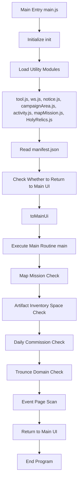
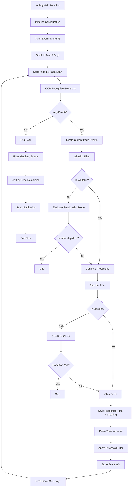
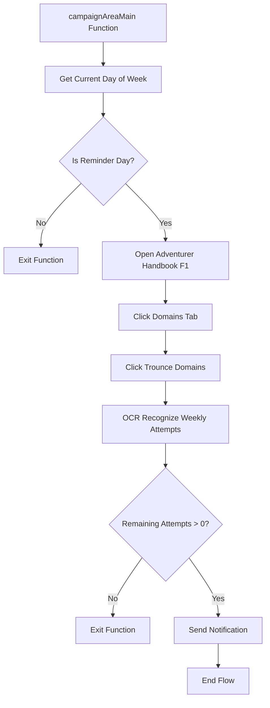
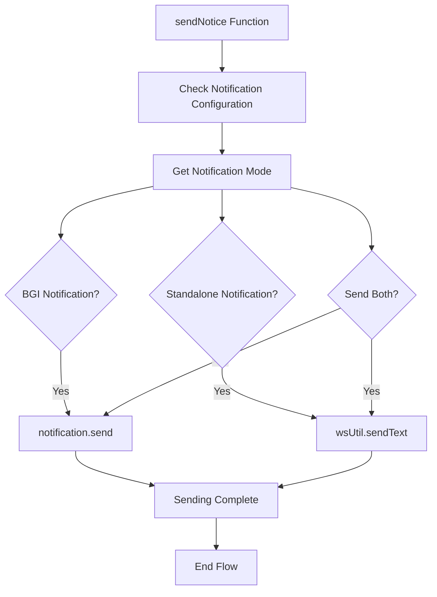
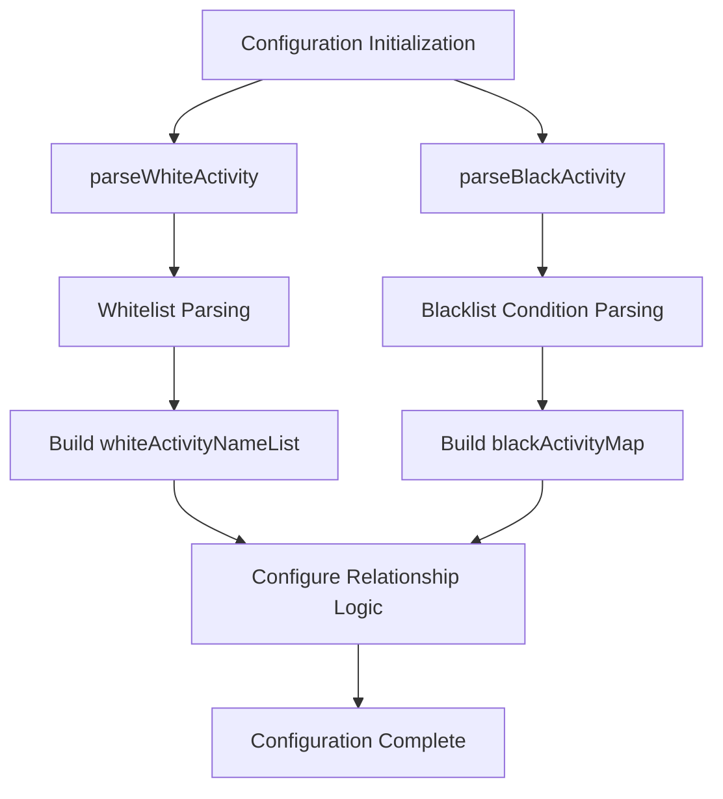
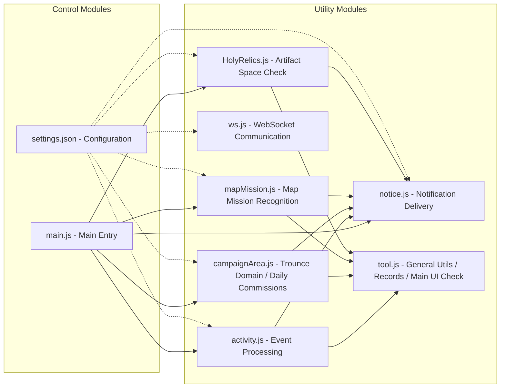
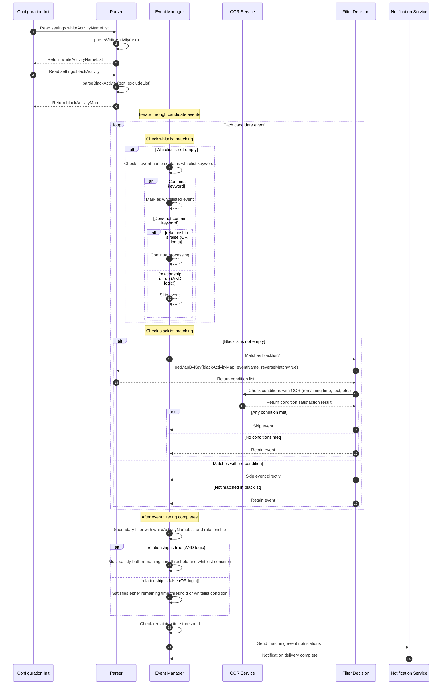

# Event Duration & Trounce Domain Notifier

## Recognition Result JSON

Running the script normally generates `recognition-result.json` in the script root directory (full path: `<BetterGI_Directory>\User\JsScript\ActivitySwitchNotice\recognition-result.json`). The filename is fixed and gets overwritten on each run without appending history. It is declared in `manifest.saved_files` to persist across script updates, and will be overwritten on the next execution.

- Top-level fields: `schemaVersion`, `runId`, `startedAt`, `updatedAt`, `finishedAt`, `status`, `stage`, `error`, `sections`. Timestamps are UTC ISO strings; `runId` uses the startup time of the current run.
- `status` can be `running` / `completed` / `failed`. `completed` only indicates that the original routine finished normally; it does not guarantee that all data was recognized successfully or that notifications were delivered. Verify the timestamps and section statuses when reading.
- Each `sections` item contains `status`, `data`, and `reason`. Statuses include `pending`, `running`, `observed`, `unknown`, `skipped`, `failed`, and `not_run` (flow exited early). `null` indicates unknown data and must not be treated as zero.

| Item | data Fields |
| --- | --- |
| `mapMission` | `requested` (selected keywords), `matches` (matched text list: `ok`, `text`); an empty list does not prove no tasks exist. |
| `holyRelics` | `text`, `count` (current count), `total` (capacity), `remaining` (available space), `threshold` (alert threshold). |
| `dailyCommission` | `daily` (commission rewards) and `physical` (Original Resin consumption); each includes `use`, `total`; non-finite values are written as `null`. |
| `longTermTrainingPoints` | `pointNumber` (points), `expireTime` (expiration number extracted via OCR), `expireTimeText` (raw expiration text); missing values are `null`; expiration number follows original OCR logic and is not a timestamp. |
| `campaignArea` | `text`, `count` (remaining half-cost resin attempts this week), `total`; marked as `skipped` on non-reminder days. |
| `activity` | `uid`, `names` (scanned names), `details` array (`name`, optional `common`, `text`, `hours`, `desc`), `complete: null` (completeness unconfirmed); subject to original filtering and pagination logic. |

Write timing: Old data is cleared and set to `running` upon initialization/before in-game actions; overwritten when stages start, recognition data is acquired (before notifying), or when skipped; set to `completed` upon completion, or `failed` with error reason on error. Unexecuted items remain `null` and do not mix with previous run data. Saved data from the current run is preserved if subsequent notification fails. Events are saved in summary after scanning finishes and before notification; if scanning fails halfway, that item has no complete result.

File writing uses `await file.writeText(path, jsonString, false)` and checks the return value. Failure on initial write terminates immediately; subsequent write failure aborts the flow and attempts to save the failed state. If the disk is unwritable, host forcefully terminates, or the process exits, writing or cleanup may fail, leaving the file as an older version, in `running` state, or as incomplete JSON. Determine execution status from run logs, timestamps, and `runId`, rather than solely by file existence. Atomic writes are not guaranteed.

## Project Overview

This is an automation script for Genshin Impact designed to automatically detect the remaining duration of in-game events and send reminders when events are about to end, as well as notify players of remaining half-cost Trounce Domain attempts on designated days of the week.

---

## Features

- ✅ Automatically returns to the game's main UI and opens the Events menu
- ✅ OCR recognition of event lists and remaining duration
- ✅ Automatically scrolls through all event pages
- ✅ Intelligent time parsing (supports formats like "22 days 14 hours")
- ✅ Configurable notification threshold (default: events ending within 8760 hours)
- ✅ Supports monitoring specific events
- ✅ Event blacklist filtering (v0.0.5 added conditional blacklist: filter only when conditions are met; empty condition means no condition)
- ✅ Anti-duplicate detection mechanism
- ✅ Exception handling and error recovery
- ✅ Automatic reminders for remaining weekly Trounce Domain half-cost claims (multi-day selection supported since v0.1.1)
- ✅ Daily Commission rewards / Original Resin / Long-Term Encounter Points reminders (v0.0.7 / v0.1.9)
- ✅ Map recognition mission reminders (v0.0.8)
- ✅ Artifact inventory space check and alert (v0.1.5)
- ✅ New event alerts with historical comparison (v0.1.0)
- ✅ Supports standalone notifications (v0.0.4 added; requires bettergi-scripts-tools and JS HTTP permissions enabled as BGI does not natively support WebSockets) [Deploy bettergi-scripts-tools](https://github.com/Kirito520Asuna/bettergi-scripts-tools)

## Core Flowcharts

### Overall Architecture Flowchart


### Event Scanning Core Flow


### Trounce Domain Reminder Flow


### Notification Mechanism


### Configuration Parsing Flow


### Core Component Dependencies


### Logic Sequence


---

## User Guide

### Quick Start

#### 1. Installation & Configuration

- Ensure game resolution is **1920×1080** (recommended resolution).
- Import the script into BetterGI Script Manager.
- Configure preferences in the script settings panel.

#### 2. Basic Settings

The following parameters can be configured in [settings.json]():

| Setting | Description | Default |
|:---|:---|:---|
| `debug` | Enable developer mode (highlights recognition boxes for debugging) | false |
| `toMainUi` | Automatically return to game main UI before execution | true |
| `noticeType` | Notification mode (BGI Notification / Standalone / Both) | BGI Notification |
| `newActivityNotice` | Enable new event notifications (records event names for historical comparison) | true |
| `mapMissionKeys` | Map recognition mission reminders (multi-select) | Battle Pass Missions, Expedition Rewards, Daily Commission Rewards |
| `relationship` | Use `AND` logic between remaining time and whitelist (default is `OR` logic) | false |
| `whiteActivityNameList` | Whitelisted event names (separated by `\|`) | Empty (monitors all events) |
| `blackActivity` | Blacklisted event names (separated by `\|`) - Supports condition syntax: `EventName-condition1,condition2` | Empty (no blacklist) |
| `notifyHoursThreshold` | Notification time remaining threshold (hours) | 8760 (365 days) |
| `activityKey` | Shortcut key to open Events menu | F5 |
| `campaignAreaReminderDays` | Trounce Domain reminder days (multi-select) | Saturday, Sunday |
| `campaignAreaKey` | Shortcut key to open Adventurer Handbook | F1 |
| `openBagKey` | Shortcut key to open Inventory | B |
| `checkHolyRelic` | Enable Artifact inventory space reminder | false |
| `holyRelicsDiffCountThreshold` | Artifact inventory remaining space threshold | 400 |
| `wsNoticeType` | Standalone notification mode (Custom Notification / bgi-tools Notification) | Custom Notification |
| `http_api_access_ws_proxy` | bgi-tools authorized wsproxy API endpoint | http://127.0.0.1:8081/bgi/ws-proxy/access |
| `bgi_tools_token` | bgi-tools authorization token, syntax: `tokenName=tokenValue` | Authorization= |
| `ws_proxy_url` | WebSocket proxy URL (standalone notification) | http://127.0.0.1:8081/bgi/ws-proxy/message/send |
| `ws_url` | WebSocket client URL (standalone notification) | ws://127.0.0.1:8080/ |
| `ws_token` | WebSocket client token (standalone notification) | Empty |
| `action` | Message delivery target (Private Message / Group Chat) | Private Message |
| `send_id` | Recipient ID (Group or QQ number depending on action) | Empty |
| `at_list` | List of user IDs to @ mention, comma-separated | Empty |

> Note: `toTopCount` and `scrollPageCount` are no longer exposed in the settings interface (internal defaults are 10 and 4).

---

### Execution Modes

#### Automatic Mode (Recommended)

1. Upon starting the script, it will automatically:
   - Check if the game is currently on the main screen.
   - Return to the main screen if not already there.
   - Open the Events menu using the configured shortcut key.
   - Begin scanning all events.

#### Manual Mode

1. Turn off the `toMainUi` option.
2. Ensure the game is already on the main screen.
3. Start the script to begin scanning.

---

### Feature Details

#### Event Filtering

- **Monitor All Events**: Leave `whiteActivityNameList` empty to monitor all events with remaining duration.
- **Monitor Specific Events**: Enter keywords such as `Lantern Rite|Flagship`, to only monitor events matching those keywords.
- **Blacklist Filtering**: `blackActivity` allows you to specify event names to ignore, separated by `|`.
- **Conditional Blacklist**: Supports condition syntax `EventName-condition1,condition2`. An event is only filtered out when the specified conditions are met.

##### Example Syntax
```text
Standard Blacklist: "Event A|Event B"
Conditional Blacklist: "Event A-Completed|Event B-condition1,condition2"
Mixed Usage: "Event A|Event C-Completed,Claimed"
```

#### Time Notification Mechanism

- Monitors all events by default (`notifyHoursThreshold` = 8760 hours).
- You can set a lower threshold, such as 24, to only receive alerts for events ending within 24 hours.
- Events ending within 24 hours are tagged with `<Ending Soon>` in notifications.

#### Logical Relationship Configuration

- **`relationship` = `false`** (default): Sends notification if either the "time threshold" OR the "whitelisted event" condition is met.
- **`relationship` = `true`**: Sends notification only if BOTH the "time threshold" AND the "whitelisted event" conditions are met.

#### Smart Anti-Duplication

- Automatically detects already scanned event pages.
- Prevents redundant scans caused by imperfect page scrolling.
- Automatically determines when the bottom of the page has been reached.

---

### Standalone Notification Setup (Added v0.0.4, bgi-tools auth in v0.1.2)

#### Configuration Options

- **`noticeType`**:
  - `BGI Notification`: Uses BetterGI's built-in notifications.
  - `Standalone Notification`: Sends notifications via WebSocket.
  - `Both`: Sends via both built-in notifications and WebSocket.

- **`wsNoticeType` (Standalone notification configuration method, added v0.1.2)**:
  - `Custom Notification`: Manually enter WebSocket parameters below.
  - `bgi-tools Notification`: Pulls authorized wsproxy configuration from bettergi-scripts-tools (requires configuring `http_api_access_ws_proxy` and `bgi_tools_token`).

- **bgi-tools Authorization Settings (added v0.1.2)**:
  - `http_api_access_ws_proxy`: API endpoint to get authorized wsproxy, defaults to `http://127.0.0.1:8081/bgi/ws-proxy/access`.
  - `bgi_tools_token`: Authorization token syntax: `tokenName=tokenValue` (e.g. `Authorization=xxx`).

- **WebSocket Configuration (Custom Notification)**:
  - `ws_proxy_url`: WebSocket proxy URL, defaults to `http://127.0.0.1:8081/bgi/ws-proxy/message/send`.
  - `ws_url`: WebSocket client URL, defaults to `ws://127.0.0.1:8080/`.
  - `ws_token`: Optional WebSocket client authentication token.

- **Delivery Configuration**:
  - `action`: Delivery target, `Private Message` or `Group Chat`.
  - `send_id`: Target group or QQ number according to `action`.
  - `at_list`: Comma-separated list of user IDs to mention.

#### Requirements

1. **Permissions**: Enable JS HTTP permissions to use standalone notifications.
2. **Server Setup**: Set up a WebSocket service / proxy server (or deploy bettergi-scripts-tools).
3. **Network Connection**: Ensure network access to the configured WebSocket server.

#### Configuration Examples

Custom Notification:
```json
{
  "noticeType": "Standalone Notification",
  "wsNoticeType": "Custom Notification",
  "ws_proxy_url": "http://127.0.0.1:8081/bgi/ws-proxy/message/send",
  "ws_url": "ws://127.0.0.1:8080/",
  "action": "Group Chat",
  "send_id": "123456789",
  "at_list": "987654321,111222333"
}
```

bgi-tools Notification:
```json
{
  "noticeType": "Standalone Notification",
  "wsNoticeType": "bgi-tools Notification",
  "http_api_access_ws_proxy": "http://127.0.0.1:8081/bgi/ws-proxy/access",
  "bgi_tools_token": "Authorization=xxx",
  "action": "Group Chat",
  "send_id": "123456789"
}
```

### Deploying [bettergi-scripts-tools](https://github.com/Kirito520Asuna/bettergi-scripts-tools)

#### 1. Windows Executable
Go to [Releases](https://github.com/Kirito520Asuna/bettergi-scripts-tools/releases), download the Windows zip package, extract it, and run the `.exe` file.

#### 2. Java JAR
Download the jar file from [Releases](https://github.com/Kirito520Asuna/bettergi-scripts-tools/releases):
```shell
java -jar xxxx.jar
```

#### 3. Docker Deployment
```shell
docker pull ghcr.io/kirito520asuna/bettergi-scripts-tools:latest
docker run -d -p 8081:8081 -v /path/to/application-prod.yml:/app/application-prod.yml --name bettergi-scripts-tools ghcr.io/kirito520asuna/bettergi-scripts-tools:latest
```

---

### Important Notes

#### Operating Environment
- ✅ Game resolution set to 1920×1080 (optimal compatibility).
- ✅ Game must be running in the foreground.
- ✅ The Events menu must open correctly with the configured shortcut key.

#### During Execution
- 🚫 Do not manually move or click the mouse while the script is running.
- 🚫 Avoid switching windows or minimizing the game.
- ⚠️ If an error occurs, simply restart the script.

---

### Advanced Configuration

#### Custom Shortcut Keys
- If your Events menu is not opened with `F5`, change `activityKey` to your key.
- If your Adventurer Handbook is not opened with `F1`, change `campaignAreaKey` to your key.

#### Notification Thresholds
Adjust `notifyHoursThreshold` based on personal preference:
- 24: Only track events ending within 24 hours.
- 168: Track events ending within a week.
- 720: Track events ending within a month.

---

### Sample Output

Notification message format:
```text
Genshin Impact Event Duration Reminder:
> Lantern Rite Festival Time Remaining: 3 days 14 hours <86 hours left>
> Windblume Festival Time Remaining: 1 day 5 hours <29 hours left> <Ending Soon>
```

---

## File Structure

```
ActivitySwitchNotice/
├── utils/
│   ├── activity.js     # Core event processing logic
│   ├── campaignArea.js # Trounce Domain / Daily Commission reminder logic
│   ├── mapMission.js   # Map mission recognition feature
│   ├── HolyRelics.js   # Artifact inventory space check feature
│   ├── notice.js       # Notification delivery module
│   ├── ws.js           # WebSocket notification module
│   └── tool.js         # General utilities (OCR / Template matching / Record / Main UI detection)
├── assets/             # Template image assets
│   ├── paimon_menu.png # Paimon menu template for main UI detection
│   └── holyRelics.jpg  # Artifact inventory tab template
├── config/             # Runtime record files (activity / campaignArea / dailyCommission)
├── main.js             # Main entry point
├── manifest.json       # Plugin manifest
├── settings.json       # User settings UI definition
└── README.md           # Documentation
```

---

## Core Modules

### `activity.js` - Core Event Logic
- `scrollPage()`: Basic page scrolling function.
- `scrollPagesByActivity()`: Scroll event list page-by-page.
- `scrollPagesByActivityToTop()`: Scroll to the top of the event list.
- `parseRemainingTimeToHours()`: Parse remaining duration text into hours.
- `OcrKey()`: OCR recognition for remaining duration.
- `activityMain()`: Main controller function for event scanning.

### `campaignArea.js` - Trounce Domain / Daily Commission Module
- `ocrWeeklyCount()`: OCR recognition for Trounce Domain weekly claims.
- `ocrDailyCommission()`: OCR recognition for Daily Commissions and Original Resin.
- `ocrLongTermTrainingPoints()`: OCR recognition for Long-Term Encounter Points.
- `campaignAreaMain()`: Main controller for Trounce Domain reminders.
- `dailyCommissionMain()`: Main controller for Daily Commission reminders.

### `mapMission.js` - Map Mission Recognition Module
- `ocrMapMission()`: OCR recognition of map task lists.
- `mapMission()`: Main controller for map mission alerts.

### `HolyRelics.js` - Artifact Inventory Space Module
- `checkHolyRelicsKey()`: Checks remaining Artifact inventory capacity and alerts user.

### `notice.js` - Notification Module
- `sendNotice()`: Sends event reminder notifications sorted by remaining duration.
- `sendText()`: Sends standard notifications.

### `ws.js` - WebSocket Notification Module
- `send()`: Sends raw WebSocket message.
- `sendText()`: Sends text message.
- `pullAccessWsProxyConfig()`: Pulls authorized wsproxy configuration from bgi-tools.

### `tool.js` - General Utility Module
- `findText()` / `findTextAndClick()`: General text OCR search and click.
- `findImg()` / `findImgAndClick()`: General template matching and click.
- `getDayOfWeek()`: Gets current weekday adjusted to 4:00 AM server reset.
- `isInMainUI()` / `toMainUi()`: Main screen check and navigation.
- `openBag()`: Opens Inventory and handles expired item popups.
- `Record`: Unified read/write helper class for record files.

---

## Settings Reference

Configurable options in `settings.json`:

| Option | Type | Description |
|:---|:---:|:---|
| `debug` | checkbox | Enable developer debug bounding boxes |
| `toMainUi` | checkbox | Return to main UI before execution |
| `noticeType` | select | Notification mode (BGI / Standalone / Both) |
| `newActivityNotice` | checkbox | Enable new event notifications |
| `mapMissionKeys` | multi-checkbox | Map recognition mission reminders |
| `relationship` | checkbox | Use `AND` logic between remaining time and whitelist |
| `whiteActivityNameList` | String | Whitelist event keywords (`\|` separated) |
| `blackActivity` | String | Blacklist event keywords (`\|` separated, supports conditions) |
| `notifyHoursThreshold` | String | Remaining time threshold (hours) |
| `activityKey` | String | Shortcut key for Events menu |
| `campaignAreaReminderDays` | multi-checkbox | Trounce Domain reminder days (multi-select) |
| `campaignAreaKey` | String | Shortcut key for Adventurer Handbook |
| `openBagKey` | String | Shortcut key for Inventory |
| `checkHolyRelic` | checkbox | Enable Artifact space reminder |
| `holyRelicsDiffCountThreshold` | String | Artifact space threshold |
| `wsNoticeType` | select | Standalone notification setup mode |
| `http_api_access_ws_proxy` | String | bgi-tools wsproxy API URL |
| `bgi_tools_token` | String | bgi-tools auth token |
| `ws_proxy_url` | String | WebSocket proxy URL |
| `ws_url` | String | WebSocket client URL |
| `ws_token` | String | WebSocket client token |
| `action` | select | Delivery type (Private Message / Group Chat) |
| `send_id` | String | Recipient ID |
| `at_list` | String | List of IDs to @ mention |

---

## How It Works

1. Automatically return to the game main interface.
2. Execute map mission recognition reminders according to configured options.
3. Perform Artifact inventory remaining space check (if enabled).
4. Perform Daily Commission rewards / Original Resin / Long-Term Encounter Points reminders.
5. Check if today is a configured reminder day (default Saturday/Sunday); if so, check remaining Trounce Domain claims.
6. Open Events menu using configured shortcut key.
7. Scroll to top of the events list.
8. Scan all events page by page.
9. Perform OCR on each event to detect remaining duration.
10. Parse duration into hours and apply whitelist/blacklist filters.
11. Send reminders for matching events.
12. Compare against previous history and notify if new events were detected.

---

## Version History

### 0.2.0 (2026-09-27)
- Bugfix: Fixed OCR recognition issue for Trounce Domains.

### 0.1.9 (2026-08-16)
- Added Long-Term Encounter Points recognition (appended to Daily Commission reminders with expiration notice).
- Optimized map mission OCR recognition.
- Refactored OCR mission recognition logic for higher accuracy.
- Optimized event page scrolling and mouse operation logic.
- Fixed page stability waiting issue during mission switch notifications.
- Updated minimum BetterGI dependency from 0.61.0 to 0.63.0.

### 0.1.8 (2026-07-08)
- Refactored event config file read/write logic (added `Record` class for unified I/O).
- Added config file management and duplicate notification suppression (prevents repeated notifications for Trounce Domains / Daily Commissions).
- Added date formatting function (`YYYY-MM-DD`).
- Optimized notification logic for Trounce Domains and Daily Commissions.

### 0.1.7 (2026-06-05)
- Fixed bugs.

### 0.1.6 (2026-05-30)
- Changed UID retrieval API to use core app.

### 0.1.5 (2026-04-24)
- Added Artifact inventory remaining space detection and reminder.

### 0.1.4 (2026-04-23)
- Implemented singleton pattern for single configuration instance.

### 0.1.3 (2026-03-28)
- Fixed issue where invalid configuration caused execution failure.

### 0.1.2 (2026-03-23)
- Added cloud configuration support.
- Updated wsproxy authorization method (auth token or pull from bettergi-scripts-tools >= 0.0.7).

### 0.1.1 (2026-03-16)
- Changed Trounce Domain reminder days to multi-select.
- Adapted to new Trounce Domain UI.

### 0.1.0 (2026-02-01)
- Added new event notifications (stores event name list for historical comparison).

### 0.0.8 (2026-01-22)
- Added map recognition mission reminders.
  
  
  

### 0.0.7 (2026-01-19)
- Added Daily Commission reminders.

### 0.0.6 (2026-01-06)
- **Feature Optimization**: Added UID recognition in notifications.

  

### 0.0.5 (2026-01-04)
- **Performance Optimization**: Optimized scroll-to-top algorithm to reduce scroll count and improve initialization efficiency.
- **Feature Enhancement**: Added conditional blacklist filtering supporting dynamic filter rules based on event state.
- **Code Refactor**: Added `parseBlackActivity` for structured parsing of blacklist settings.
- **Architecture Improvement**: Refactored blacklist matching logic with condition matching engine supporting multi-condition evaluation.
- **Data Structure Optimization**: Added `blackActivityMap` using Map data structure for faster lookup.
- **Logic Optimization**: Enhanced event filtering algorithm integrated with condition evaluation.
- **Initialization Flow**: Refactored config loading and added `init` function for unified configuration initialization.
- **Documentation**: Updated configuration docs with conditional blacklist syntax guide.

### 0.0.4 (2026-01-01)
- Added standalone notification support via WebSocket.
- Added `ws.js` module for WebSocket notifications.
- Added `noticeType` setting for choosing notification mode.
- Added `ws_proxy_url`, `ws_url`, and `ws_token` settings.
- Added `action`, `send_id`, and `at_list` delivery options.

### 0.0.3 (2025-12-29)
- Fixed event filtering logic issue, renamed `activityNameList` to `whiteActivityNameList` for consistency.
- Added mutual exclusion between blacklist and whitelist (whitelist items stripped from blacklist).
- Added `relationship` parameter in settings to control logical relation between time threshold and whitelist.
- Supported AND / OR logical relation between time threshold and whitelist.
- Displayed `Completed` status in UI markers.

### 0.0.2 (2025-12-22)
- Added Trounce Domain weekly claims reminder.
- Added `campaignArea.js` module.
- Added `campaignAreaKey` setting to customize Adventurer Handbook shortcut key.
- Added `campaignAreaReminderDay` setting for reminder day.
- Improved scroll-to-top stability.
- Added event blacklist filtering via `blackActivityNameList`.
- Supported special event duration formats (e.g. week counter for recurring events).
- Added extra OCR support for supplemental event information (e.g. "This Week's Progress").
- Improved event filtering logic and blacklist accuracy.
- Enhanced notification message format with event descriptions.
- Fixed various known bugs to improve script stability.

### 0.0.1 (2025-12-21)
- Added event duration detection and notification.
- Added OCR recognition of event list and time remaining.
- Added automatic scrolling through event pages.
- Added smart duration parsing (supports formats like "22 days 14 hours").
- Added configurable notification threshold.
- Added support for monitoring specific events.
- Added anti-duplicate detection mechanism.
- Added exception handling and error recovery.

---

## Other

Author: 云端客 (Cloud Guest)  
Feedback Email: doutianmianxia@qq.com
