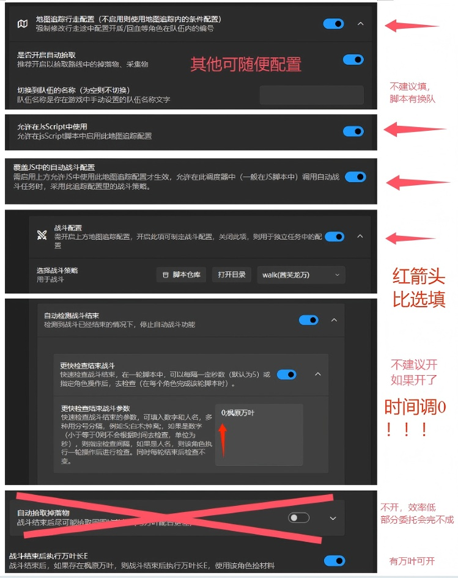

# Genshin Impact Auto Commission Script

## Project Overview
This is an automated script based on BetterGI that helps you complete Daily Commissions in Genshin Impact automatically. It recognizes commission tasks, tracks navigation paths, and intelligently handles dialogue choices.
We are currently recruiting contributors. Anyone interested is welcome to join our QQ group (even if you just help mark points or buttons on maps).

## Quick Start

### Step 1: Add Script to Scheduler
1. Subscribe to this script.
2. After adding it to the scheduler, **do not run it immediately**.

### Step 2: Configure Script Settings
Right-click the script and select "Modify JS Custom Configuration":
- **Do NOT check "Skip Commission Recognition"** (this is for developer debugging).
- Configure "Do not visit Statue of The Seven when switching parties" and "Do not go to a safe spot after completion" according to your preference.
- Set your Combat party name (leave empty to avoid party switching).
- Set your Elemental Gathering party name (must include Anemo, Pyro, and Hydro characters, plus a pillar mechanic counter).

### Step 3: Configure Scheduler Settings
- Set combat timeout to 40–60 seconds.
- It is best to disable "Auto Combat - Automatically pick up drops after combat" to avoid wasting significant time.

### Step 4: Run the Script
Close the configuration window and run the script to begin automatically completing your Daily Commissions.

## Team Configuration Recommendations

### Recommended Gathering Team
The gathering team needs to include the following elements:
- **Anemo**: Required for specific elemental cleaning commissions.
- **Pyro**: Required gathering element.
- **Hydro**: Required gathering element.
- **Pillar Counter**: Used for commissions involving 3+3 elemental totems/monuments.

**Recommended Character Lineup**: Zhongli + Sucrose + Bennett + Barbara

### Supported Characters
| Element / Role | Characters |
|---|---|
| Anemo | Sucrose, Shikanoin Heizou, Wanderer, Xianyun, Lan Yan, Kaedehara Kazuha, Faruzan, Lynette, Venti, Jean, Sayu |
| Pyro | Yanfei, Diluc, Klee, Bennett, Xiangling, Thoma, Hu Tao, Dehya, Chevreuse, Xinyan, Lyney, Yoimiya |
| Hydro | Barbara, Mona, Sangonomiya Kokomi, Mualani, Neuvillette, Furina, Nilou, Candace, Xingqiu, Kamisato Ayato |
| 3+3 Pillar Counter | Zhongli, Kaedehara Kazuha, Xianyun, Neuvillette (theoretical, not yet supported), Xiangling (theoretical, not yet supported) |

## FAQ

### Q1: Why does opening the Adventurer Handbook trigger an error?
Check whether BetterGI shortcuts (e.g. Stop Current Script) or third-party tools are bound to `F1`. If so, rebind them to another key. `F1` is the default game key for opening the Adventurer Handbook.

### Q2: Why doesn't the script attack monsters?
- Ensure you have correctly configured your combat strategy: [Combat Strategy Documentation](https://bettergi.com/feats/task/domain.html).
- You can also copy community presets: search for "Auto Commission" in the combat script repository; those are verified to work.

### Q3: Why can't it hit monsters on elevated towers?
- **Are you using Furina? If not, consider adding her.**
- Some tower monsters cannot be hit from below; set combat timeout to 40–60 seconds (adjusted for your team's build).

### Q4: Why do certain commissions fail?
- Check the [BGI Documentation](https://bettergi.com/doc.html) first.
- 99% of combat commission failures are due to party composition—**did you bring enough AOE damage?**
- If issues persist, send that day's logs from `BetterGI/log/` and commission screenshots to the author for troubleshooting.

## Developer Guide
Dialogue commission documentation: [AutoCommission Standard Dialogue Commission Creation Guide](https://cnb.cool/bettergi/bettergi-scripts-list/-/tree/main/repo/js/AutoCommission/dialogue_commission_guide.md).

## Feedback
1. Join QQ group: 1053392753
2. Email screenshots and logs to: 3302871403@qq.com
3. BetterGI QQ Channel: @星野

## Changelog

### Current Version: 0.98.18 (2026-06-04)
- Fixed known issues (2026-06-04 15:10:23 UTC).

### 0.98.17 (2026-06-04)
- **Commission Flow Fixes & Additions**:
  - *Language Exchange*, *Poetry Exchange*, *A Key to What?*: Added dialogue options and flow configurations for multiple regions, corrected retry location update logic to prevent reusing failed location data from previous attempts.
  - *A Surprise Gift*: Optimized path to find Marjorie, reducing overshoot and interaction failures.
  - *Knights of Favonius Handbook - 5th Edition*, *Food Delivery*: Polished interaction and path details.
  - *Spreading Evil*: Corrected region name from "Brightcrown Canyon" to "Brightcrown Mountains".
- **Recognition & Stability Improvements**:
  - Optimized handling when dialogue options fail to appear after approaching NPCs.
  - Switched map coordinate recognition to a voting mechanism for higher stability.
  - Updated step fallback loading logic; eliminated redundant and misleading logs.

### 0.98.16 (2026-01-30)
- **Commission Flow Updates**:
  - *A Novel Plan*: Adjusted region to Stormbearer Coast; added standard path and teleport path to the top of the tower at Stormbearer Point.
  - Added 3 retry attempts to tower climbing flow to reduce random navigation or climbing failures.
- Deleted redundant flow files and resolved argument mismatch issues during execution.

### 0.98.15 (2026-01-20)
- **Recognition Optimization**:
  - Added OCR text correction for commission and location names, reducing match failures caused by OCR misreads.
  - Prevented recognized commission locations from being overwritten by failed attempt locations on the same day.
- **Flow & Compatibility Adjustments**:
  - Adapted to core BetterGI AutoSkip changes.
  - Corrected flow filename for *A Way to Thank the Gods*.
  - Cleaned up duplicated or misnamed flow folders for *Albert, Don't Stop!* and *Ellin, the Aspiring Knight*.
- Fixed issue where version numbers were desynchronized in automated workflows; updated PR template.

### 0.98.14 (2026-01-07)
- **Update Prompts**: Added version check module to notify when script updates are available.
- **Map & OCR Optimization**:
  - Adjusted map zoom scale to fix coordinate calculation errors on certain commissions.
  - Fixed parameter verification logic for commission description detection steps.
  - Added full OCR debug logs for easier troubleshooting.
  - Expanded dialogue option OCR scanning area to avoid missed choices when options are numerous.
- **Commission Flow Fixes**:
  - *A Key to What?*: Fixed coordinate offset in Dawn Winery branch.
  - *A Surprise Gift*: Added dialogue priority choices.
  - *Language Exchange*: Fixed region branch attribution based on fallback results.
- **Automated Sync Workflow**: Added and enhanced GitHub Actions workflow for repo sync and PR generation with commit history.

### 0.98.12 (2025-12-24)
- Added `.gitattributes` to standardize repository line endings.
- Added GitHub Actions workflow to auto-sync code and open PRs.
- *A Key to What?*: Updated Dawn Winery branch configuration.
- Updated README descriptions and version configurations.

### 0.98.11 (2025-12-21)
- **Commission Flow Fixes**:
  - *Language Exchange*: Corrected pathing parameters and regional branch configuration.
  - *A Surprise Gift*: Added priority dialogue options.
  - *Floral Fresh*: Removed ban status and restored flow availability.
- **Execution & Dialogue Logic Optimization**:
  - Removed redundant parameters, corrected dialogue icon recognition bounds.
  - Synced changes with BetterGI core forced dispose mechanics.
  - Removed close-store step and updated related commission flows.
- Updated README, settings guide, and version number.

### 0.98.10 (2025-10-20)
- **New Commission Support**:
  - *Returning to Winter*
- **Commission Flow Updates**:
  - *Big Puck Trouble*: Anemo character dispels anomaly spot before switching parties to enter combat.
  - *Reliable Helper*: Updated paths.
  - *Floral Fresh*: Updated flow to correctly track parcel trails.
  - *What a Father Can Do*: Updated path to reliably reach the cathedral.
  - *Emergency Supplies*: Supported dialoguing with moving NPCs.
  - *A Boy's Letter*: Fixed failure when interacting with Draff under specific conditions.
- **Dialogue Module**:
  - When dialogue options do not match the whitelist and contain neither exit nor speech bubble icons, the script clicks the last option by default.

### 0.98.7 (2025-09-29)
- Significantly enhanced execution efficiency of commission flows.
- Added automated support for *Post Haste*.
- Completed flow for the *Pigeons Go AWOL* series.
- Optimized 13 commission config files to improve precision.
- Refactored dialogue handler code for simpler maintenance.
- Improved combat commission tracking and dialogue detection.
- Modified 16 files in total (+761 lines, -505 lines).

### 0.98.6
- Added image utility library (`image_utils.js`).
- Enhanced dialogue handler functionality.
- Added shop closing feature (`close-store.js`).
- Added support for numerous commissions:
  - Many new dialogue commissions.
  - Multiple new pathing routes.
  - Emergency Supplies commission series.
  - Regional special commission optimizations.
- Optimized constants and main controller logic.
- Fixed numerous known issues across 105 files.

### 0.98.5
- Modified 80+ files with general updates and bug fixes.

### 0.98.4
- Modular architecture completed; added 18 dialogue commissions and 113 execution flows.

### 0.98.2
- Added 83 character portrait templates and 8 dialogue commissions.

### 0.97
- Fixed known issues; completed additional dialogue commissions.

### 0.96
- Optimized dialogue commission processing logic.
- Optimized combat commission handling.
- Enhanced intelligent recognition of NPC dialogue options.
- Supported custom dialogue priority options.
- Added NPC whitelist feature to improve interaction accuracy.
- Improved documentation for JSON and simplified formats.

### 0.95
- Completed dialogue commission core implementation.

### 0.94.1
- Fixed high-risk climbing issues.
- Completed additional dialogue commissions.
- Fixed missing commission bug.

### 0.94
- Fixed climbing issues.
- Created dedicated folders for dialogue commissions.

### 0.93
- Fixed known issues.

### 0.92
- Fixed naming errors in several paths.
- Fixed recognition failure on 4th commission.

### 0.91
- Updated navigation to attempt both paths.
- Fixed exit error when commissions are already complete.
- Added input verification.

### 0.90
- Basic commission recognition implementation.
- Supported OCR recognition of commission locations.
- Implemented foundational commission path navigation.
