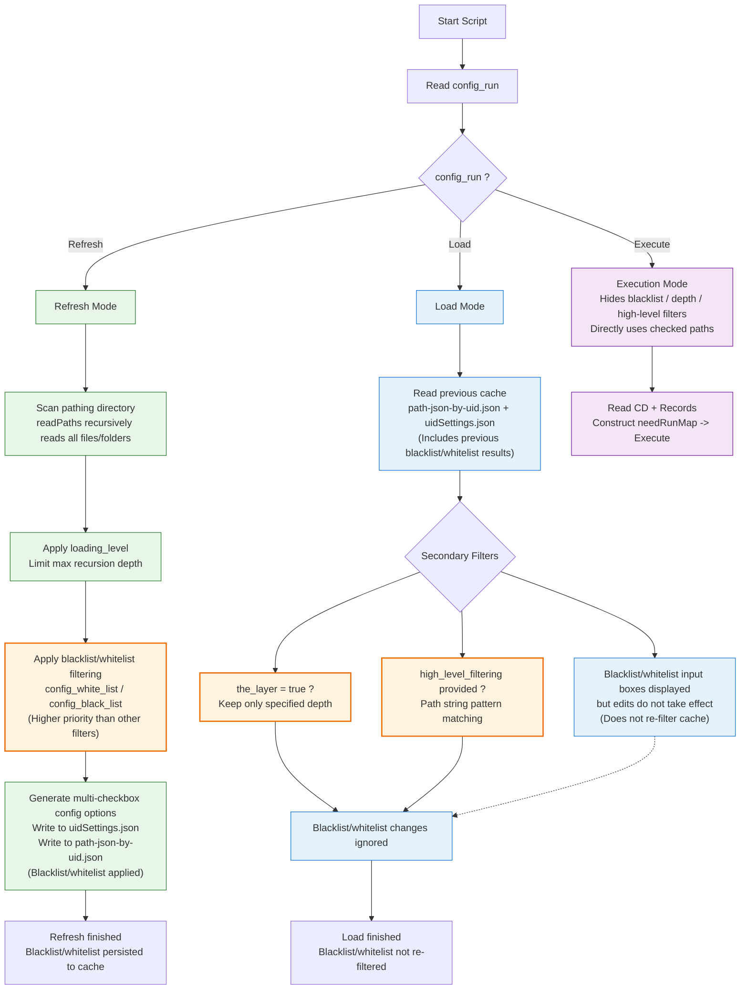
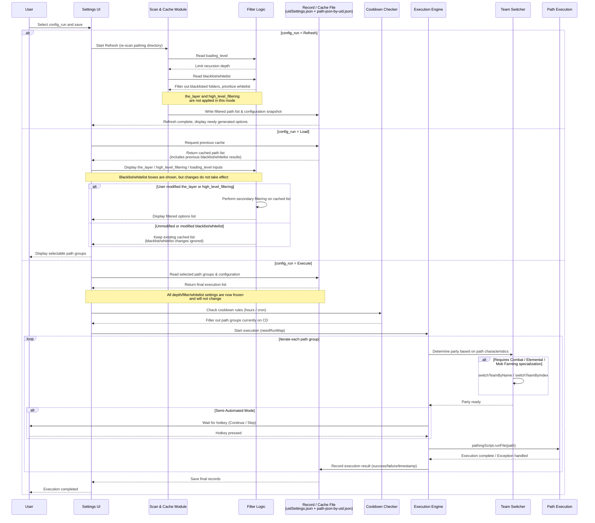

# FullyAutoAndSemiAutoTools

**Fully Automated + Semi-Automated Pathing Toolbox**  

## Project Overview

FullyAutoAndSemiAutoTools is a highly modular and customizable automated pathing execution toolbox.

Supports both **Fully Automated** and **Semi-Automated** operating modes. Core goals include:

- Intelligent scanning & multi-tier management of large numbers of pathing files (supports arbitrary directory depths)
- Fine-grained cooldown control (hours + Cron, requires external parsing service) based on route CDs
- Automatic switching between combat / elemental parties based on route characteristics
- Integrated real-time auxiliary features
- Execution history to prevent duplicates + optimization mode prioritizing uncompleted paths
- Blacklist/whitelist filtering, multi-UID record isolation, and per-account path caching

## Quick Start
1. **(Initial Setup / Storage Refresh)**: Set the refresh depth under Account Refresh, run once (automatically detects and saves UID), and enter the Version Key.  
   <br>
   <br>
2. **Execution**:  
   **Select Fully Automated**<br>
   <br>
   **The CD calculation requires deploying [bettergi-scripts-tools](https://github.com/Kirito520Asuna/bettergi-scripts-tools/releases) and enabling HTTP.<br>
   Alternatively, enable Optimization Mode (Optimization Mode does not depend on bettergi-scripts-tools).**<br>
   <br>
   <br>
   **Daily Use: Select Fully Automated**<br>
   <br>
   **Party Configuration**<br>
   Configure the default movement party.<br>
   Party syntax mapping order: Ore, Pyro, Hydro, Anemo, Electro, Dendro, Cryo, Geo.<br>
   Example syntax: `Mining,HydroPyroAnemoElectro,HydroPyroAnemoElectro,HydroPyroAnemoElectro,Elemental,Mining`<br>
   Leave empty if unused, e.g. `Mining,,,,,Mining`<br>
   **Mob Farming Party Configuration**<br>
   Example syntax: `Enemies and Monsters->Clockwork Meka=Speedrun,.....` (refer to the Mob Farming Party Configuration Mapping diagram below)<br>
   <br>
   **Mob Farming Party Configuration Mapping**<br>
   <br>
   **Select Execution Groups**<br>
   Multiple selections operate with an OR relationship.<br>
   E.g., selecting `Local Specialties` -> `Liyue` and `Liyue` -> `Cor Lapis` will execute all paths under `Local Specialties` -> `Liyue`.<br>
   To run specific paths only, do not select parent folders. E.g., when selecting the level-3 path `Cor Lapis`, do not select the level-2 parent `Liyue`.<br>
   <br>
   <br>
3. For advanced configurations, please continue reading the documentation below.

### Core Highlights (Latest Version)

- **Completely Refactored Path Scanning**: Supports arbitrary directory depth with clear parent-child hierarchies and stable performance.
- **Per-UID Path Caching** (`path-json-by-uid.json`): Lightning-fast switching between multiple accounts.
- Dual cooldown system with Hours & Cron (requires bettergi-scripts-tools).
- Intelligent party switching (Combat / Seven Elements).
- Real-time tasks: Auto dialog skip, auto pickup, auto combat.
- Prioritized execution + execution tracking + error path logging.
- Semi-automated hotkey overrides (Continue / Skip).
- Developer mode + detailed logging + automatic UID detection.

## File Structure Overview

```text
FullyAutoAndSemiAutoTools/
├── config/
│   ├── SevenElement.json           # Seven Elements path -> team mapping
│   ├── cd-pathing.json             # Path cooldown rules (hours/cron)
│   ├── record.json                 # Current run execution log
│   ├── PathRecord.json             # Historical path execution log
│   ├── uidSettings.json            # User configuration snapshot (multi-UID support)
│   ├── path-json-by-uid.json       # Path JSON list cached per UID
│   └── RefreshSettings.json        # Refresh configuration cache (optional)
├── utils/
│   ├── SwitchTeam.js               # Team switching core
│   ├── cron.js                     # Cron parsing utility
│   └── tool.js                     # UID detection module
├── pathing/                        # ★ Pathing directory (symbolic link required)
├── SymLink.bat                     # One-click script to create pathing link
├── main.js                         # Main entry point (refactored scanner)
├── manifest.json                   # Script metadata & version tag
└── settings.json                   # Configuration template (UI schema)
```

## Core Workflow Diagrams

### 1. Overall Flowchart



### 2. Execution Sequence Diagram



## Important Configuration Options (settings.json)

| Setting Name | Type | Main Function | Recommended Default / Example |
|---|---|---|---|
| config_uid | Checkbox | Current configuration UID display (informative only) | xxx |
| key | Text | Script License Key | xxx |
| config_run | Dropdown | Run Mode: Refresh / Load / Execute | Refresh -> First time, Load -> Daily |
| refresh_record | Checkbox | Clear run history when refreshing configuration | Unchecked |
| refresh_record_mode | Dropdown | Run history clear mode: All / UID | UID |
| high_level_filtering | Text | High-level string pattern filtering | Empty |
| loading_level | Text | Path directory depth (>= 1) | 2 or 3 |
| the_layer | Checkbox | Load only specified directory depth | Unchecked |
| order_rules | Text | Custom execution order rules (optional)<br>Syntax: `ParentFolder->Folder=OrderInt,...`<br>Example: `Food and Alchemy->Crystalfly=1,` | `""` (Default scan order) or `"Food and Alchemy->Crystalfly=1,pathing->Local Specialties=2"` |
| open_limit_max | Checkbox | Enable max route limit per execution group | Unchecked |
| limit_max_group | Text | Configure max routes per execution group (optional)<br>Syntax: `ParentFolder->Folder=MaxPaths,...`<br>Example: `Food and Alchemy->Crystalfly=50,` | `""` or `"Food and Alchemy->Crystalfly=50,pathing->Local Specialties=50"` |
| config_white_list | Text | Whitelist keywords (comma-separated) | `Crystalfly,Local Specialties` |
| config_black_list | Text | Blacklist keywords (higher priority) | `Other,Mob Farming,Weekly Boss` |
| open_cd | Checkbox | Enable route cooldown control | Recommended: Checked |
| http_api | Text | Cron parsing service address | `http://127.0.0.1:8081/...` |
| real_time_missions | Multi-select | Real-time assists (Dialogue / Combat / Pickup) | Enable at least "Auto Pickup" |
| choose_best | Checkbox | Optimization mode (prioritizes unrun/least recently run routes) | Recommended: Checked |
| mode | Dropdown | Fully Automated / Semi-Automated | Fully Automated (Daily) |
| auto_semi_key_mode | Dropdown | Semi-auto hotkey behavior (Continue / Skip) | Continue |
| auto_key | Text | Semi-auto intervention hotkey | F10 / F11 (avoid conflicts) |
| team_fight | Text | General movement/runner party name | Required |
| team_hoe_ground | Text | Mob farming specialized party configuration (Syntax: `Parent->Child=TeamName,...`) | `Enemies and Monsters->Floating Fungi=FungiTeam` |
| team_seven_elements | Text | Seven Elements parties (Ore, Pyro, Hydro, Anemo, Electro, Dendro, Cryo, Geo) | Fill in sequence |
| is_debug | Checkbox | Developer mode (detailed logging) | Checked when debugging |

## Syntax Guide

### high_level_filtering (High-Level Filtering)
```text
Syntax: xxx->xxx-> ..... (arbitrary depth)

Example folder: pathing\Local Specialties\
Syntax: Local Specialties

Example folder: pathing\Local Specialties\Fontaine\
Syntax: Local Specialties->Fontaine

Example folder: pathing\Local Specialties\Fontaine\Lumitoile\
Syntax: Local Specialties->Fontaine->Lumitoile

Example folder: pathing\Local Specialties\Fontaine\Lumitoile\Lumitoile@jbcaaa\
Syntax: Local Specialties->Fontaine->Lumitoile->Lumitoile@jbcaaa
```

Keep consistent syntax styles across your configuration. Do not mix competing syntax patterns for the same paths, which may cause execution errors.

### order_rules (Execution Order Rules)
1. `rootName` is the first folder under root, `parentName` is the parent directory name, `name` is the folder name.
2. Recommended syntax: `rootName->parentName->name=1,rootName->parentName->name2=2`
3. When `rootName=parentName`, the syntax `rootName->parentName->name=1` is invalid; use `parentName->name=1` instead.
4. The syntax `rootName->name=1` is not supported.
5. Matching priority: `rootName->parentName->name` > `parentName->name` > Default order.

### team_hoe_ground (Mob Farming Team Configuration)
1. `rootName` is the first folder under root, `parentName` is the parent directory name, `name` is the folder name.
2. Recommended syntax: `rootName->parentName->name=TeamName,rootName->parentName->name2=TeamName`
3. When `rootName=parentName`, use `parentName->name=TeamName`.
4. Matching priority: `rootName->parentName->name` > `parentName->name` > Default order.

### limit_max_group (Execution Group Max Paths)
1. `parentName` is the parent directory name, `name` is the folder name.
2. Recommended syntax: `parentName->name=50,parentName->name2=50`
3. Matching priority: `parentName->name` > Default order.

## (Optional) Additional JSON Configuration Files

### Configuration item: order_rules
File path: `config/PathOrder.json`  
Higher `order` values indicate higher execution priority. (Reserved range: 900~700 for mob farming modules).
```json
[
  {
    "uid": "",
    // Account UID
    "is_common": false,
    // Whether this is a shared global configuration
    "root_name": "",
    // Folder name under root
    "parent_name": "",
    // Parent folder name
    "name": "",
    // Target folder name
    "order": 0
    // Execution priority order
  }
]
```

### Configuration item: team_hoe_ground
File path: `config/HoeGround.json`
```json
[
  {
    "uid": "",
    // Account UID
    "is_common": false,
    // Whether this is a shared global configuration
    "root_name": "",
    // Folder name under root
    "parent_name": "",
    // Parent folder name
    "name": "",
    // Target folder name
    "team_name": ""
    // Party name in-game
  }
]
```

## Cooldown Rule Example (cd-pathing.json)
Higher `level` values have higher priority.
```json
[
  {
    "name": "Crystalfly",
    "type": "hours",
    "level": 2,
    "value": 12
  },
  {
    "name": "Local Specialties",
    "type": "hours",
    "level": 1,
    "value": 46
  },
  {
    "name": "Minerals",
    "type": "cron",
    "level": 1,
    "value": "0 0 0 1/3 * ?"
  }
]
```

## Example Run Log
Example: Running `Rainbowdrop Crystal` under the `Minerals` category. Log screenshot upon completion and re-running:  


## Cron Parsing Service Deployment (Required for Cron CD)

**bettergi-scripts-tools** is required for Cron parsing. Please deploy using at least one of the following methods (requires version v0.0.3+):

### 1. Windows Executable
Download the Windows zip archive from [GitHub Releases](https://github.com/Kirito520Asuna/bettergi-scripts-tools/releases) -> extract -> run `.exe`.

### 2. Java JAR
Download the JAR file and execute:
```bash
java -jar bettergi-scripts-tools-xxxx.jar
```

### 3. Docker Deployment
```bash
docker pull ghcr.io/kirito520asuna/bettergi-scripts-tools:latest
docker run -d -p 8081:8081 --name bettergi-scripts-tools ghcr.io/kirito520asuna/bettergi-scripts-tools:latest
```

**Default API URL**: `http://127.0.0.1:8081/bgi/cron/next-timestamp/all`

## Recommended Workflow

1. Double-click `SymLink.bat` to create the `pathing` link.
2. For initial use, perform a **Refresh** once (generates `path-json-by-uid.json` cache).
3. For daily routines, use **Load** mode to quickly restore configurations and path lists.
4. Adjust checked path groups -> switch to **Execute** mode -> start execution.

**Multi-Account Friendly**: Each UID maintains an independent path cache, making account switching instantaneous without rescanning.

## Tips & Practical Advice

- **Most convenient setup**: Fully Automated + Optimization Mode + Auto Pickup + Cooldown Control.
- **Safest setup**: Semi-Automated + Auto Pickup + Detailed Logging + Comprehensive Blacklists.
- Directory depth is unrestricted; the scanner supports arbitrary folder hierarchies.
- If a problematic path fails repeatedly, inspect `record.json` and blacklist or fix the route.
- Multi-UID users: Run "Refresh" once on each account to initialize individual caches.

## Precautions / Notes

- On initial use or after updates, delete legacy `path-json-by-uid.json` and regenerate.
- In semi-automated mode, ensure the hotkey does not conflict with BetterGI or other software.
- Cron mode requires deploying the external parsing service, otherwise cooldown checks are skipped.
- Minimum compatible BetterGI version: `0.54.3+`.

## Version Key

| Version | Key |
|---|---|
| 0.0.1 | PGCSBY37NJA |

## Version History

### 0.0.1 (2026-01-30)
- Initial feature release.

**Author**: 云端客 (Kirito520Asuna)

Happy automated farming, Traveler! May your materials never run dry! ✨
