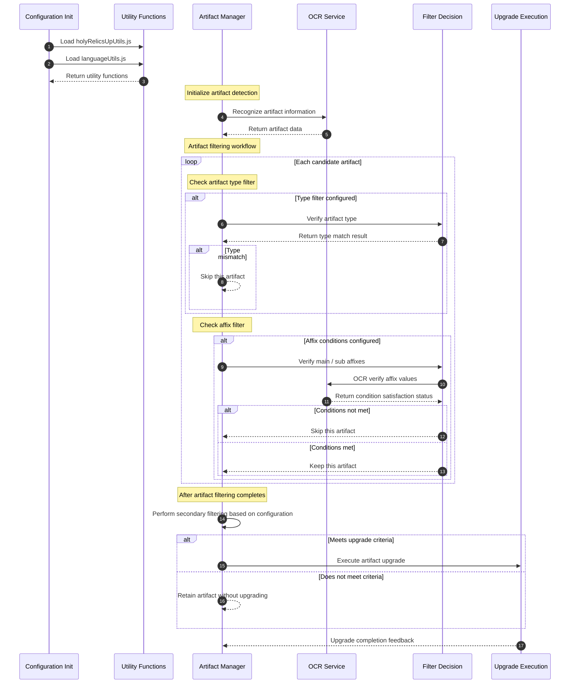

# Batch Artifact Enhancement

Feature Description: Opens the Inventory screen, sorts artifacts in ascending order of level (unmaxed first), and continuously enhances the first artifact until reaching your configured maximum target level before proceeding to the next. You can also specify the total number of artifacts to enhance.

## Precautions / Notes

1. **Resolution Recommendation**: Please ensure your Genshin Impact resolution is 1920x1080 (1080p). While the script has partial compatibility with other resolutions, they have not been thoroughly tested.
2. **Filter Issue**: Selecting "Select All" during artifact filtering may cause failures; this issue is currently unresolved.

## Core Logic Workflow

## Core Features

1. **Batch Artifact Enhancement**: Supports batch enhancing artifacts, looping through upgrades until reaching the target level.
2. **Material Insertion Selection & Auto-Detection**: Supports selecting material insertion method (default: Auto Detect). Note: When target level is set to 4, 8, or 16, "Step-by-Step Insertion" is enforced.
3. **Maximum Enhancement Level**: Configurable target enhancement level (default: 4). If materials are insufficient, enhancement stops (e.g. target is +20 but materials only reach +17, step-by-step stops at +16).
4. **Maximum Artifact Upgrade Count**: Configurable limit for the number of artifacts to enhance.
5. **Affix Sorting**: Supports sorting by stats using abbreviations separated by `|`. Supported abbreviations:

| Abbr. | Stat | Abbr. | Stat |
|:--:|:----:|:-----:|:-------:|
| % | Percentage | 物伤 | Physical DMG Bonus |
| 生命 | HP | 风伤 | Anemo DMG Bonus |
| 防御 | DEF | 水伤 | Hydro DMG Bonus |
| 攻击 | ATK | 雷伤 | Electro DMG Bonus |
| 治疗 | Healing Bonus | 岩伤 | Geo DMG Bonus |
| 精通 | Elemental Mastery | 草伤 | Dendro DMG Bonus |
| 暴率 / 爆率 | CRIT Rate | 冰伤 | Cryo DMG Bonus |
| 暴伤 / 爆伤 | CRIT DMG | 火伤 | Pyro DMG Bonus |
| 充能 | Energy Recharge | — | — |

**Example**: `生命%` (HP%) represents HP Percentage.  
**Notes**:
- `生命%|防御%|攻击%|治疗`: Only the first three take effect (`生命%|防御%|攻击%`).
- Duplicate attributes (e.g., `生命%|生命%|攻击%`) are automatically deduplicated to `生命%|攻击%`.
- Priority order is `1|2|3`.

6. **Artifact Set Filtering**: Supports filtering by set name (e.g. `如雷|苍白` for Thundering Fury / Pale Flame), using fuzzy matching with no count restrictions.

## Configuration Guide

The following configuration options (based on `settings.json`) can be adjusted before running:

1. **Refresh Settings by Language** (`refreshSettingsByLanguage`)
    - Type: Checkbox
    - Description: Whether to refresh settings list display based on selected language.
    - Default: Disabled

2. **Language Selection** (`language`)
    - Type: Dropdown
    - Description: Select interface display language.
    - Options: `Simplified Chinese`, `Traditional Chinese`, `English`, `Japanese`, `Korean`
    - Default: `Simplified Chinese`

3. **Auto Enter Inventory** (`toBag`)
    - Type: Checkbox
    - Description: Automatically open the inventory page.
    - Default: Enabled

4. **Enable Batch Enhancement** (`enableBatchUp`)
    - Type: Checkbox
    - Description: Enable batch enhancement. When used standalone, ensure artifacts are filtered to unmaxed status.
    - Default: Disabled

5. **Default Enhancement Interface** (`defaultEnhancedInterface`)
    - Type: Dropdown
    - Description: Select default enhancement tab (Details | Enhance) to adapt to UI updates.
    - Options: `Details`, `Enhance`
    - Default: `Enhance`

6. **Auto Material Insertion Method** (`enableInsertionMethod`)
    - Type: Checkbox
    - Description: Automatically select material insertion method (Quick Insert / Step-by-Step).
    - Default: Disabled

7. **Material Insertion Method** (`insertionMethod`)
    - Type: Dropdown
    - Description: Choose material insertion method (default: Auto Detect). Forced to Step-by-Step when target level is 4, 8, or 16.
    - Options: `Default`, `Quick Insert`, `Step-by-Step`
    - Default: `Default`

8. **Select Material Rarity** (`material`)
    - Type: Dropdown
    - Description: Select enhancement materials to use (default: Auto Detect). *Note: Currently disabled due to detection timing issues.*
    - Options: `Default`, `1-Star`, `2-Star and below`, `3-Star and below`, `4-Star and below`
    - Default: `Default`

9. **Maximum Artifacts to Enhance** (`upMaxCount`)
    - Type: Text input
    - Description: Number of artifacts to enhance.
    - Default: Empty

10. **Target Enhancement Level** (`upMax`)
    - Type: Dropdown
    - Description: Target level for artifact enhancement.
    - Options: `4`, `8`, `16`, `20`
    - Default: `4`

11. **Enable Target Affix Matching** (`enableAttributeHolyRelic`)
    - Type: Checkbox
    - Description: Whether to enable target affix matching (experimental). Does not support ascending order or +20 enhancements when maxed/unmaxed filters are selected in descending order.
    - Default: Disabled

12. **Custom Affix Overwrites General Affix** (`coverAttributeHolyRelic`)
    - Type: Checkbox
    - Description: When enabled, custom target affixes overwrite general target affixes per slot. If disabled, only custom target affixes are used (experimental).
    - Default: Enabled

13. **General Target Affixes** (`commonAttributeHolyRelic`)
    - Type: Text input
    - Description: General target affixes using specific syntax (experimental).
      **Syntax Guide**:
        - `@`: Piece slot (Flower: 花 / 生之花, Feather: 羽 / 羽毛 / 死之羽, Sands: 沙 / 时之沙, Goblet: 杯 / 杯子 / 空之杯, Circlet: 冠 / 理之冠).
        - `#`: Main stat (e.g. 生命%, 物伤). Cannot be omitted when present; must terminate with `&`.
        - `*`: Substat (e.g. 爆率, 爆伤). Terminator `!` can be omitted.
        - `|`: Piece delimiter.
        - `&`: Main stat terminator.
        - `!`: Substat terminator (optional).
    - Default: `@花*爆率*爆伤|@羽*爆率*爆伤|@沙*爆率*爆伤|@冠#爆率#爆伤&*爆率*爆伤|@杯#物伤#风伤#水伤#火伤#雷伤#岩伤#冰伤#草伤&*爆率*爆伤`

14. **Custom Target Affixes** (`inputAttributeHolyRelic`)
    - Type: Text input
    - Description: Custom target affixes following general syntax.
    - Default: Empty

15. **Custom Pre-Filter Affixes Overwrite General** (`coverSiftAttributeHolyRelic`)
    - Type: Checkbox
    - Description: Overwrites general filter affixes with custom filter affixes per piece slot for initial filtering before enhancement.
    - Default: Enabled

16. **Require Meeting All Filter Sub-Affix Conditions** (`meetAllSiftAttributeHolyRelic`)
    - Type: Checkbox
    - Description: When enabled, strictly requires meeting all specified substat conditions during initial filtering.
    - Default: Disabled

17. **General Pre-Filter Target Affixes** (`commonSiftAttributeHolyRelic`)
    - Type: Text input
    - Description: General filter affixes applied during initial artifact filtering before enhancement.
    - Default: `@花*爆率*爆伤|@羽*爆率*爆伤|@沙*爆率*爆伤|@冠#爆率#爆伤&*爆率*爆伤|@杯#物伤#风伤#水伤#火伤#雷伤#岩伤#冰伤#草伤&*爆率*爆伤`

18. **Custom Pre-Filter Target Affixes** (`inputSiftAttributeHolyRelic`)
    - Type: Text input
    - Description: Custom filter affixes for initial filtering.
    - Default: Empty

19. **Enable Auto Sorting** (`toSort`)
    - Type: Checkbox
    - Description: Toggles automatic sorting before enhancement.
    - Default: Enabled

20. **Stat Sorting Priority** (`sortAttribute`)
    - Type: Text input
    - Description: Stat sorting order separated by `|` (e.g. `生命%|雷伤|充能|通用`).
    - Default: Empty

21. **Primary Sort Direction** (`sortMain`)
    - Type: Dropdown
    - Description: Primary sort order.
    - Options: `Ascending`, `Descending`
    - Default: `Ascending`

22. **Secondary Sort Rule** (`sortAuxiliary`)
    - Type: Dropdown
    - Description: Secondary sort order.
    - Options: `Level Order`, `Quality Order`
    - Default: `Level Order`

23. **Enable Artifact Filter** (`toSift`)
    - Type: Checkbox
    - Description: Toggles artifact set filtering.
    - Default: Enabled

24. **Artifact Set Filter** (`suit`)
    - Type: Text input
    - Description: Filter by set name separated by `|` (e.g. `如雷|苍白`).
    - Default: Empty

25. **Max Filter Page Turns** (`countMaxByHoly`)
    - Type: Dropdown
    - Options: `1` to `8`
    - Default: `4`

26. **Artifact State Filter** (`selectSuit`)
    - Type: Multi-select checkbox
    - Options: `Marked`, `Locked Only`, `Unlocked`, `Equipped`, `Unequipped`, `Sanctifying Elixir Defined`
    - Default: Empty

27–32. *(Deprecated legacy filter checkboxes removed in v1.2.0)*

33. **Open Inventory Key** (`knapsackKey`)
    - Type: Text input
    - Description: Shortcut key to open inventory.
    - Default: `B`

34. **Debug Logging** (`log_off`)
    - Type: Checkbox
    - Description: Enables detailed logging for debugging.
    - Default: Disabled

## Version History

### 1.2.0 (2026-01-09)
- Adapted to BetterGI multi-select configuration options.

### 1.1.9 (2026-01-05)
- Fixed error recognition issues.

### 1.1.8 (2025-12-09)
- Replaced dynamic resolution detection with fixed resolution values.

### 1.1.7 (2025-12-05)
- Added `defaultEnhancedInterface` configuration option to choose default enhancement tab (Details | Enhance).

### 1.1.6 (2025-09-21)
- Added Traditional Chinese support.
- Added validation guard mechanism for target affixes.

### 1.1.5 (2025-09-21)
- Added `refreshSettingsByLanguage` and `language` configuration options.
- Updated interface labels to support dynamic multilingual display.

### 1.1.4 (2025-09-12)
- Added multilingual framework supporting dynamic configuration.

### 1.1.3 (2025-09-11)
- Added artifact filtering configuration options (`coverSiftAttributeHolyRelic`, `meetAllSiftAttributeHolyRelic`, etc.).

## Language Cross-Reference Table

| Simplified Chinese | Traditional Chinese | English | Japanese | Korean | Syntax Abbreviation |
|:----:|:----:|:-----------:|:---:|:----:|:---:|
| 生之花 | 生之花 | Flower of Life | 生の花 | 생의 꽃 | 花 |
| 死之羽 | 死之羽 | Plume of Death | 死の羽 | 죽음의 날개 | 羽 |
| 时之沙 | 時之沙 | Sands of Eon | 時の砂 | 시의 모래 | 沙 |
| 空之杯 | 空之杯 | Goblet of Eonothem | 空のカップ | 빈 컵 | 杯 |
| 理之冠 | 理之冠 | Circlet of Logos | 理の冠 | 이론의 왕관 | 冠 |

| Simplified Chinese | Traditional Chinese | English | Japanese | Korean | Syntax Abbreviation |
|:----:|:----:|:-----------:|:---:|:----:|:---:|
| 百分比 | 百分比 | Percentage | パーセンテージ | 퍼센트 | % |
| 防御力 | 防禦力 | DEF | 防御力 | 방어력 | 防御 |
| 攻击力 | 攻擊力 | ATK | 攻撃力 | 공격력 | 攻击 |
| 生命值 | 生命值 | HP | HP | 생명력 | 生命 |
| 暴击率 | 暴擊率 | CRIT Rate | 暴撃率 | 치명률 | 暴率 |
| 暴击伤害 | 暴擊傷害 | CRIT DMG | 暴撃ダメージ | 치명피해 | 暴伤 |
| 元素充能 | 元素充能 | Energy Recharge | 元素チャージ | 원소 충전 | 充能 |
| 元素精通 | 元素精通 | Elemental Mastery | 元素達人 | 원소 숙련도 | 精通 |
| 治疗加成 | 治療加成 | Healing Bonus | ヒーリングボーナス | 치료 보너스 | 治疗 |
| 物理伤害加成 | 物理傷害加成 | Physical DMG Bonus | 物理ダメージボーナス | 물리 피해 보너스 | 物伤 |
| 火元素伤害加成 | 火元素傷害加成 | Pyro DMG Bonus | ファイアダメージボーナス | 파이로 피해 보너스 | 火伤 |
| 水元素伤害加成 | 水元素傷害加成 | Hydro DMG Bonus | ウォーターダメージボーナス | 하이드로 피해 보너스 | 水伤 |
| 雷元素伤害加成 | 雷元素傷害加成 | Electro DMG Bonus | エレクトロダメージボーナス | 전기 피해 보너스 | 雷伤 |
| 草元素伤害加成 | 草元素傷害加成 | Dendro DMG Bonus | デンドロダメージボーナス | 덴드로 피해 보너스 | 草伤 |
| 冰元素伤害加成 | 冰元素傷害加成 | Cryo DMG Bonus | クリオダメージボーナス | 크리오 피해 보너스 | 冰伤 |
| 岩元素伤害加成 | 岩元素傷害加成 | Geo DMG Bonus | ジオダメージボーナス | 지오 피해 보너스 | 岩伤 |
| 风元素伤害加成 | 風元素傷害加成 | Anemo DMG Bonus | アネモダメージボーナス | 앤메오 피해 보너스 | 风伤 |

## Other Information

- **Developer Multilingual Adaptation**:
    - `utils/languageUtils`: Core configuration for multilingual framework.
    - `assets/language/`: Local language template match images.

- **Author**: 云端客 (Cloud Guest)
- **Feedback Email**: doutianmianxia@qq.com
