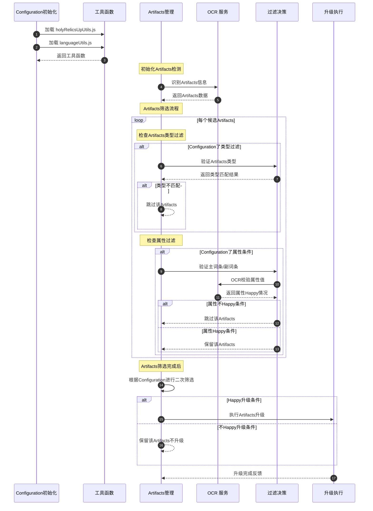

# Artifacts批量强化

Features描述：打开Inventory页面、按照未满级和等级升序排列后对首个Artifacts进行循环强化直到达到你Settings的最大等级后继续执行下一个。还可以Settings强化多少个Artifacts。

## Precautions / Notes

1. **分辨率建议**：请尽量确保原神游戏分辨率为1920x1080(尽量在1K下运行)。虽然脚本已兼容Other分辨率，但Other分辨率未经过充分测试。
2. **筛选问题**：Artifacts筛选时选择“全选”可能导致Defeat，此问题暂时无法解决。
## 核心逻辑流程

## 核心Features

1. **批量强化Artifacts**：Supports对Artifacts进行批量强化，Auto 循环强化直到达到指定等级。
2. **素材放入方式的选择和自识别**：Supports选择素材放入方式（默认：Auto 识别）。Note：当最大强化等级Settings为4、8、16时，强制使用“阶段放入”方式。
3. **最大强化等级**：可Settings强化目标等级（默认：4）。当材料不足时，强化会停止（例如：目标+20，但材料仅够+17，若选择阶段放入，会停在+16）。
4. **最大Artifacts强化个数**：SupportsSettings需要强化的Artifacts数量。
5. **属性排序**：Supports按属性排序，使用简称，格式使用`|`分隔。Supports的简称如下：

| 简称 |  全称  |  简称   |   全称    |
|:--:|:----:|:-----:|:-------:|
| %  | 百分比  |  物伤   | 物理伤害加成  |
| 生命 | 生命值  |  风伤   | 风元素伤害加成 |
| 防御 | 防御力  |  水伤   | 水元素伤害加成 |
| 攻击 | 攻击力  |  雷伤   | 雷元素伤害加成 |
| 治疗 | 治疗加成 |  岩伤   | 岩元素伤害加成 |
| 精通 | 元素精通 |  草伤   | 草元素伤害加成 |
| 暴率 | 暴击率  |  冰伤   | 冰元素伤害加成 |
| 爆率 | 暴击率  |  火伤   | 火元素伤害加成 |
| 暴伤 | 暴击伤害 |  充能   | 元素充能效率  |
| 爆伤 | 暴击伤害 | ~~无~~ |  ~~无~~  |

**示例**：`生命%` 等价于 `生命值%`，均表示生命值百分比。  
**Note**：

- `生命%|防御%|攻击%|治疗` 只生效前三个（`生命%|防御%|攻击%`）。
- 重复属性（如 `生命%|生命%|攻击%`）会Auto 去重，仅保留 `生命%|攻击%`。
- 顺序为 `1|2|3`。

6. **Artifacts套装筛选**：Supports按Artifacts套装筛选（如：`如雷|苍白`），使用模糊匹配，无次数限制。

## ConfigurationGuide / Instructions

以下为脚本的Configuration项（基于 `settings.json`），可在脚本运行前调整：

1. **根据语言刷新Settings列表** (`refreshSettingsByLanguage`) **[1.1.5 新增]**
    - 类型：复选框
    - 描述：是否根据选择的语言刷新Settings列表的显示内容。
    - 默认：禁用

2. **语言选择** (`language`) **[1.1.5 新增]**
    - 类型：下拉菜单
    - 描述：选择界面显示的语言。
    - 选项：`简体中文`、`繁體中文`、`English`、`日本語`、`한국어`
    - 默认：`简体中文`

3. **启用Auto 进入Inventory** (`toBag`)
    - 类型：复选框
    - 描述：是否Auto 打开Inventory页面。
    - 默认：启用

4. **启用批量强化** (`enableBatchUp`)
    - 类型：复选框
    - 描述：启用批量强化Features。单独使用时，请确保ArtifactsInventory已筛选为未满级状态。
    - 默认：禁用

5. **默认强化界面** (`defaultEnhancedInterface`) **[1.1.7 新增]**
    - 类型：下拉菜单
    - 描述：选择默认进入的强化界面（详情|强化）。适配米哈游对默认强化界面的修改。
    - 选项：`详情`、`强化`
    - 默认：`强化`

6. **Auto 启用放入方式** (`enableInsertionMethod`)
    - 类型：复选框
    - 描述：Auto 选择素材放入方式（快捷放入/阶段放入）。
    - 默认：禁用

7. **放入方式** (`insertionMethod`)
    - 类型：下拉菜单
    - 描述：选择素材放入方式（默认：Auto 识别）。当最大强化等级为4、8、16时，强制使用“阶段放入”。
    - 选项：`默认`、`快捷放入`、`阶段放入`
    - 默认：`默认`

8. **选择素材** (`material`)
    - 类型：下拉菜单
    - 描述：选择强化使用的素材（默认：Auto 识别）。**注：此Features存在问题消失太快无法识别，禁用**。
    - 选项：`默认`、`1星素材`、`2星及以下素材`、`3星及以下素材`、`4星及以下素材`
    - 默认：`默认`

9. **最大Artifacts强化个数** (`upMaxCount`)
    - 类型：文本输入
    - 描述：Settings需要强化的Artifacts数量。
    - 默认：空

10. **最大强化等级** (`upMax`)
    - 类型：下拉菜单
    - 描述：SettingsArtifacts强化的目标等级。
    - 选项：`4`、`8`、`16`、`20`
    - 默认：`4`

11. **启用命中属性** (`enableAttributeHolyRelic`)
    - 类型：复选框
    - 描述：是否启用命中属性Features（实验Features）。不Supports在升序情况下使用,不Supports降序选中满级|未满级条件下强化+20操作。
    - 默认：禁用

12. **启用自定义命中属性覆盖通用命中属性** (`coverAttributeHolyRelic`)
    - 类型：复选框
    - 描述：启用后，自定义命中属性将覆盖通用命中属性（以部件为单位）。若禁用，则仅使用自定义命中属性，不使用通用命中属性（实验Features）。  
      **特别Guide / Instructions**：假设通用命中属性为 `@花*爆率*爆伤|@羽*爆率*爆伤|@沙*爆率*爆伤|@冠#爆率#爆伤&*爆率*爆伤|@杯#物伤#风伤#水伤#火伤#雷伤#岩伤#冰伤#草伤&*爆率*爆伤`，自定义命中属性为 `@花*爆率`，启用此选项时，仅“花”部件的命中属性会被覆盖为 `@花*爆率`，Other部件仍使用通用命中属性。若禁用此选项，则仅使用自定义命中属性（如 `@花*爆率`），完全忽略通用命中属性。
    - 默认：启用

13. **通用命中属性** (`commonAttributeHolyRelic`)
    - 类型：文本输入
    - 描述：Settings通用的命中属性，格式需遵循特定语法（实验Features）。  
      **语法Guide / Instructions**：
        - `@`：表示部件，需使用以下部件简称或全称（两者均可）：

          | 简称 | 全称 | 简称 | 全称 |
                    |:----:|:----:|:----:|:----:|
          | 羽 | 死之羽 | 花 | 生之花 |
          | 羽毛 | 死之羽 | 沙 | 时之沙 |
          | 杯 | 空之杯 | 冠 | 理之冠 |
          | 杯子 | 空之杯 |

        - `#`：表示主词条（如生命%、物伤）。主词条存在时不可忽略，需以 `&` 终止。
        - `*`：表示副词条（如爆率、爆伤）。副词条可忽略终止符 `!`，但建议添加以提高清晰度。
        - `|`：表示部件终止，多个部件时不可忽略。
        - `&`：表示主词条终止，主词条存在时不可忽略。
        - `!`：表示副词条终止，可忽略。
        - 属性排序的简称也Supports命中属性。
        - **示例**：
            - `@花*生命%*攻击!|@杯#生命%#物伤&*生命%!` 表示：
                - 花：副词条为生命%、攻击。
                - 杯：主词条为生命%或物伤，副词条为生命%。
            - 简化为：`@花*生命%*攻击|@杯#生命%#物伤&*生命%`（`!` 可省略）。
            - 使用全称：`@生之花*生命%*攻击|@空之杯#生命%#物伤&*生命%`（效果同上）。
    - 默认：`@花*爆率*爆伤|@羽*爆率*爆伤|@沙*爆率*爆伤|@冠#爆率#爆伤&*爆率*爆伤|@杯#物伤#风伤#水伤#火伤#雷伤#岩伤#冰伤#草伤&*爆率*爆伤`

14. **自定义命中属性** (`inputAttributeHolyRelic`)
    - 类型：文本输入
    - 描述：Settings自定义的命中属性，格式直接参考通用命中属性（`commonAttributeHolyRelic` ）的语法（实验Features）。Supports使用“核心Features”中属性排序的简称表及部件简称或全称。
    - 默认：空

15. **启用筛选Artifacts自定义命中属性覆盖筛选Artifacts通用命中属性** (`coverSiftAttributeHolyRelic`) **[1.1.3 新增]**
    - 类型：复选框
    - 描述：启用后，自定义筛选Artifacts属性（`inputSiftAttributeHolyRelic`）将覆盖通用筛选Artifacts属性（ `commonSiftAttributeHolyRelic` ），以部件为单位。若禁用，则仅使用自定义筛选Artifacts属性，完全忽略通用筛选Artifacts属性（实验Features）。  
      **特别Guide / Instructions**：假设通用筛选属性为 `@花*爆率*爆伤|@羽*爆率*爆伤`，自定义筛选属性为 `@花*生命%`，启用此选项时，仅“花”部件的筛选属性会被覆盖为 `@花*生命%`，Other部件仍使用通用筛选属性。若禁用此选项，则仅使用自定义筛选属性（如 `@花*生命%`），完全忽略通用筛选属性。  
      **Note**：此Configuration仅用于强化前的第一次Artifacts筛选。
    - 默认：启用

16. **启用筛选ArtifactsHappy所有指定的子属性命中条件** (`meetAllSiftAttributeHolyRelic`) **[1.1.3 新增]**
    - 类型：复选框
    -
    描述：启用后，筛选Artifacts时将严格要求Happy所有指定的子属性条件（实验Features）。若禁用，则筛选条件可能不要求全部子属性都Happy。  
    **Note**：此Configuration仅用于强化前的第一次Artifacts筛选。
    - 默认：关闭

17. **筛选Artifacts通用命中属性** (`commonSiftAttributeHolyRelic`) **[1.1.3 新增]**
    - 类型：文本输入
    - 描述：Settings通用的Artifacts筛选属性，格式遵循与通用命中属性（`commonAttributeHolyRelic` ）相同的语法（实验Features）。用于在强化前筛选符合条件的Artifacts。  
      **语法Guide / Instructions**：同 `commonAttributeHolyRelic`，Supports使用“核心Features”中属性排序的简称表及部件简称或全称。  
      **示例**：`@花*生命%*攻击|@杯#生命%#物伤&*生命%`
      表示筛选“花”部件副词条包含生命%和攻击、“杯”部件主词条为生命%或物伤且副词条包含生命%的Artifacts。  
      **Note**：此Configuration仅用于强化前的第一次Artifacts筛选。
    - 默认：`@花*爆率*爆伤|@羽*爆率*爆伤|@沙*爆率*爆伤|@冠#爆率#爆伤&*爆率*爆伤|@杯#物伤#风伤#水伤#火伤#雷伤#岩伤#冰伤#草伤&*爆率*爆伤`

18. **筛选Artifacts自定义命中属性** (`inputSiftAttributeHolyRelic`) **[1.1.3 新增]**
    - 类型：文本输入
    - 描述：Settings自定义的Artifacts筛选属性，格式直接参考通用筛选Artifacts属性（`commonSiftAttributeHolyRelic` ）的语法（实验Features）。用于在强化前筛选符合条件的Artifacts。  
      **语法Guide / Instructions**：同 `commonAttributeHolyRelic`，Supports使用“核心Features”中属性排序的简称表及部件简称或全称。  
      **Note**：此Configuration仅用于强化前的第一次Artifacts筛选。
    - 默认：空

19. **启用Auto 排序** (`toSort`)
    - 类型：复选框
    - 描述：是否启用Auto 排序Features。若禁用，以下排序相关Configuration无效。
    - 默认：启用

20. **属性排序** (`sortAttribute`)
    - 类型：文本输入
    - 描述：Settings排序属性，使用“|”分隔，Supports简称（如：`生命%|雷伤|充能|通用`）。
    - 默认：空

21. **主排序** (`sortMain`)
    - 类型：下拉菜单
    - 描述：Settings主排序方式。
    - 选项：`升序`、`降序`
    - 默认：`升序`

22. **辅助排序** (`sortAuxiliary`)
    - 类型：下拉菜单
    - 描述：Settings辅助排序方式。
    - 选项：`等级顺序`、`品质顺序`
    - 默认：`等级顺序`

23. **启用筛选Artifacts开关** (`toSift`)
    - 类型：复选框
    - 描述：是否启用Artifacts筛选Features。若禁用，以下筛选相关Configuration无效。
    - 默认：启用

24. **Artifacts筛选** (`suit`)
    - 类型：文本输入
    - 描述：按Artifacts套装筛选，使用 `|` 分隔，Supports模糊匹配（如：`如雷|苍白`）。
    - 默认：空

25. **筛选Artifacts界面最大翻页次数** (`countMaxByHoly`)
    - 类型：下拉菜单
    - 描述：Settings筛选Artifacts时的最大翻页次数。
    - 选项：`1`、`2`、`3`、`4`、`5`、`6`、`7`、`8`
    - 默认：`4`
26. **Artifacts筛选** (`selectSuit`)
     - 类型：多选框
    - 描述：Artifacts筛选。
    - 选项：`标记`,`仅锁定`,`未锁定`,`已装备`,`未装备`,`Sanctifying Elixir定义`
    - 默认：空
27. ~~**Artifacts筛选：锁定状态（标记）** (`holyRelicsLockMark`)~~ **[1.2.0 删除]**
     - 类型：复选框
     - 描述：筛选带有标记的Artifacts。
     - 默认：禁用
28.  ~~**Artifacts筛选：仅锁定** (`holyRelicsLockY`)~~ **[1.2.0 删除]**
     - 类型：复选框
     - 描述：筛选已锁定的Artifacts。
     - 默认：禁用
29. ~~**Artifacts筛选：未锁定** (`holyRelicsLockN`)~~ **[1.2.0 删除]**
     - 类型：复选框
     - 描述：筛选未锁定的Artifacts。
     - 默认：禁用
30. ~~**Artifacts筛选：已装备** (`holyRelicsEquipY`)~~ **[1.2.0 删除]**
     - 类型：复选框
     - 描述：筛选已装备的Artifacts。
     - 默认：禁用
31. ~~**Artifacts筛选：未装备** (`holyRelicsEquipN`)~~ **[1.2.0 删除]**
    - 类型：复选框
    - 描述：筛选未装备的Artifacts。
    - 默认：禁用
32. ~~**Artifacts筛选：来源（Sanctifying Elixir定义）** (`holyRelicsSourceFrostSaint`)~~ **[1.2.0 删除]**
    - 类型：复选框
    - 描述：筛选来源为“Sanctifying Elixir定义”的Artifacts。
    - 默认：禁用

33. **打开Inventory按键** (`knapsackKey`)
    - 类型：文本输入
    - 描述：Settings打开Inventory的Shortcut Keys。
    - 默认：`B`

34. **Log开关** (`log_off`)
    - 类型：复选框
    - 描述：启用LogRecording，用于开发者Debug。
    - 默认：禁用

## Version历史

### 1.2.0 (2026-01-09)
 - 适配 bgi 多选项
### 1.1.9 (2026-01-05)
- **修复**
  - Exception / Error识别 问题
### 1.1.8 (2025-12-09)
- **新增** **[1.1.8 新增]**：
    - 使用固定分辨率值替换Dynamic获取(应 https://github.com/babalae/bettergi-scripts-list/pull/2464 修改)

### 1.1.7 (2025-12-05)

- **新增** **[1.1.7 新增]**：
    - 添加 `defaultEnhancedInterface` Configuration项，Supports选择默认强化界面（详情|强化）。适配米哈游对默认强化界面的修改。
如图：

### 1.1.6 (2025-09-21)

- **新增** **[1.1.6 新增]**：
    - 新增繁体中文Supports (受到OCR影响无法SupportsEnglish中间空格把词拆成了多个词)
    - 解决方案:建议同JS脚本
      ==>更改游戏语言。\n更改遊戲語言。\nChange the game language.\nゲーム言語を変更します。\n게임 언어를 변경하십시오.<==
      一同使用可解决OCR不兼容的问题
- **优化** **[1.1.6 新增]**：
    - 命中属性新增验证防止机制

### 1.1.5 (2025-09-21)

- **新增** **[1.1.5 新增]**：
    - 添加 `refreshSettingsByLanguage` Configuration项，Supports根据语言刷新Settings列表的显示内容。
    - 添加 `language` Configuration项，Supports选择界面语言（简体中文、繁體中文、English、日本語、한국어）。
    - 更新界面标签，Supports多语言Dynamic显示。
- **优化** **[1.1.5 新增]**：
    - 优化多语言模块，增强语言Switch的流畅性和Stable性。
    - 改进 `languageMap` 管理，SupportsDynamic加载多语言Configuration文件。
    - 提高错误提示的友好性，语言SwitchDefeat时提供更清晰的反馈。

### 1.1.4 (2025-09-12)

- **新增**：添加多语言模块框架，SupportsDynamic语言Configuration（当前仅实现简体中文 `zh-cn`，Other语言如英文 `en-us` 等尚未实现，ExpectantOtherAuthor贡献）。
- **适配**：
    - 优化图片Path管理，通过 `commonMap` 和 `languageMap` 实现DynamicPath加载，Supports多语言扩展。
    - 增强模板匹配Features，新增 `templateMatchFindByJson` 和 `templateMatchClickByJson`，提高代码复用性和维护性。
    - 改进错误提示，语言Configuration缺失时提供Supports语言列表。

### 1.1.3 (2025-09-11)

- **新增** **[1.1.3 新增]**：
    - 添加筛选Artifacts属性相关Configuration：
        - `coverSiftAttributeHolyRelic`：Supports自定义筛选属性覆盖通用筛选属性。
        - `meetAllSiftAttributeHolyRelic`：Supports严格要求Happy所有子属性条件。
        - `commonSiftAttributeHolyRelic`：定义通用命中筛选属性。
        - `inputSiftAttributeHolyRelic`：Supports自定义命中筛选属性。
        - 以上Configuration仅用于强化前的第一次Artifacts筛选。
- **适配**：
    - Artifacts属性待激活属性适配。

## 语言对照

---
**Please refer to unsupported languages`/`未サポートの言語を参照してください`/`지원되지 않는 언어를 참조하세요**
---
| 简体中文 | 繁体中文 |   English   | 日本語 | 한국어  | Write syntax in contrast to Chinese `/`中国語と対照して文法を書く`/`중국어와 대조하여 문법 작성하기 |
|:----:|:----:|:-----------:|:---:|:----:|:------------------------------------------------------------------------:|
| 生之花  | 生之花  | Life Flower | 生の花 | 생의 꽃 |花|
| 死之羽  | 死之羽  | Death Feather | 死の羽 | 죽음의 날개 |羽|
| 时之沙  | 時之沙  | Time Sand | 時の砂 | 시의 모래 |沙|
| 空之杯  | 空之杯  | Empty Cup | 空のカップ | 빈 컵 |杯|
| 理之冠  | 理之冠  | Reason Crown | 理の冠 | 이론의 왕관 |冠|
 ---
| 简体中文 | 繁体中文 |   English   | 日本語 | 한국어  | Write syntax in contrast to Chinese `/`中国語と対照して文法を書く`/`중국어와 대조하여 문법 작성하기 |
|:----:|:----:|:-----------:|:---:|:----:|:------------------------------------------------------------------------:|
|百分比|百分比|Percentage|パーセンテージ|퍼센트|                                    %                                     |
|防御力|防禦力|Defense|防御力|방어력|                                    防御                                    |
|攻击力|攻擊力|Attack|攻撃力|공격력|                                    攻击                                    |
|生命值|生命值|HP|HP|생명력|                                    生命                                    |
|暴击率|暴擊率|Critical Rate|暴撃率|치명률|                                    暴率                                    |
|暴击伤害|暴擊傷害|Critical Damage|暴撃ダメージ|치명피해|                                    暴伤                                    |
|元素充能|元素充能|Elemental Recharge|元素チャージ|원소 충전|充能
|元素精通|元素精通|Elemental Mastery|元素達人|원소 숙련도|精通
|治疗加成|治療加成|Healing Bonus|ヒーリングボーナス|치료 보너스|治疗
|伤害加成|傷害加成|Damage Bonus|ダメージボーナス|피해 보너스|~~/~~
|元素伤害加成|元素傷害加成|Elemental Damage Bonus|元素ダメージボーナス|원소 피해 보너스|~~/~~
|物理伤害加成|物理傷害加成|Physical Damage Bonus|物理ダメージボーナス|물리 피해 보너스|物伤
|火元素伤害加成|火元素傷害加成|Pyro Damage Bonus|ファイアダメージボーナス|파이로 피해 보너스|火伤
|水元素伤害加成|水元素傷害加成|Hydro Damage Bonus|ウォーターダメージボーナス|하이드로 피해 보너스|水伤
|雷元素伤害加成|雷元素傷害加成|Electro Damage Bonus|エレクトロダメージボーナス|전기 피해 보너스|雷伤
|草元素伤害加成|草元素傷害加成|Dendro Damage Bonus|デンドロダメージボーナス|덴드로 피해 보너스|草伤
|冰元素伤害加成|冰元素傷害加成|Cryo Damage Bonus|クリオダメージボーナス|크리오 피해 보너스|冰伤
|岩元素伤害加成|岩元素傷害加成|Geo Damage Bonus|ジオダメージボーナス|지오 피해 보너스|岩伤
|风元素伤害加成|風元素傷害加成|Anemo Damage Bonus|アネモダメージボーナス|앤메오 피해 보너스|风伤
---
### **已Supports`繁体中文`对照简称**

---
| 簡稱 | 全稱 | 簡稱 | 全稱 |
|:----:|:----:|:----:|:----:|
| 羽 | 死之羽 | 花 | 生之花 |
| 羽毛 | 死之羽 | 沙 | 時之沙 |
| 杯 | 空之杯 | 冠 | 理之冠 |
| 杯子 | 空之杯 |
---
| 簡稱 |  全稱  |  簡稱   |   全稱    |
|:--:|:----:|:-----:|:-------:|
| %  | 百分比  |  物傷   | 物理傷害加成  |
| 生命 | 生命值  |  风傷   | 風元素傷害加成 |
| 防禦 | 防禦力  |  水傷   | 水元素傷害加成 |
| 攻擊 | 攻擊力  |  雷傷   | 雷元素傷害加成 |
| 治療 | 治療加成 |  岩傷   | 岩元素傷害加成 |
| 精通 | 元素精通 |  草傷   | 草元素傷害加成 |
| 暴率 | 暴擊率  |  冰傷   | 冰元素傷害加成 |
| 爆率 | 暴擊率  |   火傷   | 火元素傷害加成 |
| 暴傷 | 暴擊傷害 |  充能   | 元素充能效率  |
| 爆傷 | 暴擊傷害 | ~~无~~ |  ~~无~~  |
---
## Other

- **多语言适配(开发者)请Note**：
    - utils/languageUtils 为 多语言模块框架 的全部Configuration
    - assets/language/ 为 多语言模块框架 的本地语言匹配图片

- **Author**：云端客
- **脚本反馈邮箱**：doutianmianxia@qq.com