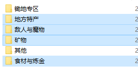
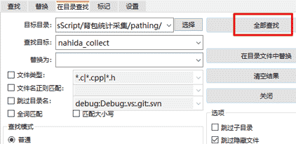
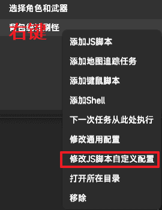
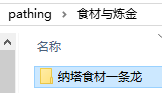
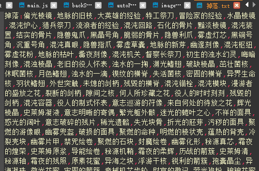

# Inventory材料统计 v2.68  
Author：吉吉喵  

<!-- 新增：全局图片样式，控制连续图片同行显示 -->
<style>
  /* 1. 同行图片容器：解决Flex拉伸问题 */
  .img-row-container {
    display: flex;
    flex-wrap: wrap; /* 宽度不足时Auto 换行，避免挤压 */
    gap: 15px; /* 图片间距，避免紧贴 */
    justify-content: center; /* 整体居中，优化排版 */
    align-items: flex-start; /* 关键！禁止垂直拉伸，图片按自身高度排列 */
    margin: 15px 0;
    max-width: 100%; /* 避免容器超宽，适配编辑器宽度 */
  }

  /* 2. 图片核心样式：Happy「X＜200px不缩放+等比例」 */
  .auto-scale-img {
    /* 小图Protection：宽度＜200px时保持原始尺寸，不被拉伸 */
    width: auto; /* 禁止强制宽度，优先用原始宽度 */
    max-width: 100%; /* 小图（＜200px）时，宽度=原始宽度 */
    
    /* 大图缩放：宽度≥200px时，最大缩至600px（可自定义） */
    min-width: auto; /* 排除最小宽度限制 */
    max-width: 600px; /* 大图最大宽度，超过则等比例缩小 */
    
    /* 比例锁定：无论何种布局，都保持原始宽高比 */
    height: auto !important; /* 强制高度Auto 适配，覆盖所有拉伸样式 */
    object-fit: contain; /* 极端情况（如容器强制固定高度）下，确保图片完整且比例不变 */
    display: block; /* 避免图片下方多余空白 */
  }
</style>


## 一、简介  
可统计Inventory内养成道具、部分食物、素材的数量，并根据「设定目标数量」「材料刷新CD」Auto 执行Mining、采集、刷怪等Path。  

### 核心优势  
1. **Auto CD判断**：无Manual Required关注材料刷新状态，脚本Auto 识别CD是否就绪；  
2. **灵活Path管理**：Supports自定义添加Path，Auto 排除低效/无效Path；  
3. **独立名单识别**：不与路边NPC、Statue of The Seven交互；可自定义识别名单（操作见「四、问题解答Q4」）；  
4. **实时弹窗Protection**：内置弹窗模块（覆盖路边信件、过期物品、月卡、Investigating等场景），运行时全程ProtectionPath不被弹窗干扰。  
5. **Auto 黑名单**：内置拾取模块，联动材料统计，可识别爆满的Path材料，Auto 屏蔽。  
6. **Path检测码**：根据Path生成检测码，可识别改名但坐标未变的Path文件，Auto 匹配带检测码的PathRecording。  
7. **怪物材料防爆仓**：对怪物材料Path添加多重机制，防止蓝紫怪物材料爆仓（怪物材料Path执行时，不会拾Other的怪物材料，除非pathing文件夹里存在且未超量）。  


## 二、用前须知  
1. 需具备基础电脑操作能力（如文件夹复制、Path查找）；  
2. 非1080p显示器，使用前需要根据显示器调整Inventory物品界面的 拖动距离 ，Recommended“一次划页稍小于4行材料的距离”；  
3. 脚本不自带Path文件，Manual Required对目标文件夹进行操作（步骤见「三、Usage」）。  


## 三、Usage  
### 3.1 基础教程（PathConfiguration）  
#### 步骤1：订阅Path文件  
在仓库中订阅所需的Path文件，参考以下截图操作：  
<div class="img-row-container">
  
  
  
  
</div>

#### 步骤2：复制Path到目标文件夹  
1. 打开**Path源文件夹**（存放订阅的Path文件）：  
   ```
   BetterGI\Repos\bettergi-scripts-list-git\repo\pathing
   ```  
2. 根据需求，复制以下类型的Path文件夹（按需选择）：  
   - Local Specialties  
   - Enemies and Monsters  
   - Minerals  
   - Food and Alchemy  
3. 粘贴到**脚本目标文件夹**（Inventory材料统计的Path读取目录）：  
   ```
   BetterGI\User\JsScript\Inventory材料统计\pathing
   ```  

#### 步骤2关键Note点  
- 手动删除重复Path（例如“Condessence Crystal”可能存在多个重复Path，Manual Required清理），参考截图：  
  <div class="img-row-container">
    
  </div>  
- `pathing` 文件夹仅Supports**6层子文件夹**，若超过6层Manual Required削减（否则无法读取）；  
- Recommended优先Configuration「FontaineUnderwater」Path：无队伍要求，但需提前开启UnderwaterTeleport Waypoint。  

#### 步骤3：按队伍分组管理Path  
建议复制多份「Inventory材料统计」脚本，按队伍Features分组存放适配Path，避免Path混乱。**例如：把该JS复制三份，改名后，分别放入不同的Configuration组。给每个JS所在的Configuration组，Configuration对应的切队等（也可以单独添加切队JS）。每个JS放置该队能适配的Path文件。分Path挺费时间，按自己需要，琢磨好队伍来。队伍适合的话，包括抓鱼、Fowl、Mining等等Path都可以适配，不一定按采集刷怪附魔来。**示例如下：  

| 分组名称               | 适配队伍组合                      | 适用场景                  | 特殊Guide / Instructions                          |  
|------------------------|-----------------------------------|---------------------------|-----------------------------------|  
| Inventory统计采集组（生存队） | Dehya + Barbara + Yaoyao + Nahida    | 常规材料采集              | Without Nahida时，需批量搜索Path中“nahida_collect”并排除 |  
| Inventory统计刷怪组         | Mavuika + 奶奶 + Zhongli + Kaedehara Kazuha        | 挂机刷怪（获取怪物材料、含Combat的采集）  | 确保队伍输出足够，能Efficient清理怪物  |  
| Inventory统计附魔材料组     | Zhongli + Barbara + Kuki Shinobu + Sucrose/Bennett | 附魔类采集（需特定附魔）  | 根据材料Path需求选择附魔Character，有Combat则增加输出Character      |  

分组示例与Without Nahida排除Path操作截图：  
<div class="img-row-container">
  
  
</div>

#### 步骤4：打开脚本自定义Settings  
1. 找到Configuration组内已添加的「Inventory材料统计」JS；  
2. 右键点击该文件，选择「修改JS 脚本自定义Settings」；  
3. 操作参考截图：  
   <div class="img-row-container">
     
   </div>  


### 3.2 JS 自定义Settings（核心Configuration项）  
| Configuration项               | FeaturesGuide / Instructions                                                                 | 操作建议                                                                 |  
|----------------------|--------------------------------------------------------------------------|--------------------------------------------------------------------------|  
| 1. 目标数量          | 当一般材料数量**低于此值**时，该材料的Path才会被纳入执行序列           | Recommended默认，管理Path下一般材料的目标数量，**怪物名**文件夹下的Path需要用**超量阈值**约束                          |  
| 2. 优先级材料        | 无视“目标数量”限制，直接纳入执行序列顶层（最高优先级）                   | 填写当前急需材料（例：Rainbowdrop Crystal,巡陆艇）；无则默认           |  
| 3. 时间成本          | 当一个Path有3~5次运行Recording后，Auto 计算“单材料获取时间”；50代表该材料类型的前50%的中EfficientPath | 保持默认即可，无需频繁修改（可过滤低效Path）                          |  
| 4. 发送通知          | ① 每类材料跑完通知一次；② 全部材料跑完汇总通知一次（需开启BGI通知）      | 建议开启，方便实时了解进度（接收端如企业微信需自行Configuration）                   |  
| 5. 取消扫描          | 取消“每个Path执行后”的Inventory扫描，仅保留“全部执行前/后”2次扫描             | Recommended默认；有效PathRecording达3条以上时可以开启，可节约运行时间                                     |  
| 6. 怪物材料过滤      | 默认只过滤掉📁pathing中已有的超量材料，若勾选，则只拾取📁pathing已有的未超量材料，不拾取Other材料           | RecommendedInventory爆炸的玩家开启；                                     |  
| 7. 超量阈值          | 首次扫描后，超量的材料，将从**Path名单**和**识别名单**中剔除，默认9000          | Recommended默认，可Auto 避免爆Inventory，这个是约束**所有**材料Path的参数         |  
| 8. 统计选择          | 📁pathing材料：包含一般材料和怪物材料Path；【扫描额外的分类】：Inventory材料统计，联动生成超量材料；【测算模式】：可预估执行时间，无Recording默认2分钟           | 根据需要选择，【扫描额外的分类】扫描到的超量材料会在Auto 拾取里排除；                                     |  
| 9. 弹窗名            | 不选则默认循环执行 `assets\imageClick` 文件夹下所有弹窗；填写则仅执行指定弹窗 | Recommended默认，需单独适配某类弹窗时填写（例：月卡,复苏）              |  
| 10. 弹窗循环间隔     | 不选则默认15秒 | Recommended默认              |  
| 11. 采用的 CD 分类   | 不选则默认执行 `materialsCD` 文件夹内Configuration的CD分类；填写则仅执行指定CD分类          | Recommended默认；新增材料时，需在该文件夹同步ConfigurationCD规则（操作见「四、问题解答Q2」）         |  
| 12. 终止时刻         | 不填则不执行定时终止；Path无时间Recording时，会预判Path耗时5分钟，且预留2分钟空闲          | Recommended默认；填写需要按24小时格式（例：4:10）         |  
| 13. 采用的识别名单   | 不选则默认执行 `targetText` 文件夹内Configuration的识别名单；填写则仅执行指定识别名单          | Recommended默认；新增名单时，需符合Configuration规则（操作见「四、问题解答Q4」）         |  
| 14. 拖动距离         | 解决非1080p分辨率下“划页过头”问题，需调整到“一次划页≤4行”                | 拖动点建议选“第五行材料附近”；大于1080p屏可适当减小数值    |  


## 四、Precautions / Notes  
1. **禁止联机请求**：联机请求会遮挡Inventory菜单，导致材料识别Defeat。建议在本脚本前添加「AutoPermission」权限SettingsJS（仓库可查），默认禁止联机；  
2. **文件夹层级限制**：`pathing` 文件夹仅Supports6层子文件夹，超过Manual Required削减（否则Path无法读取）；  
3. **仓库Path交叉资源点**：把明显重复的同资源Path删除，减少提炼Path的时间；  
4. **关键文件备份**：建议不定期备份 `pathing` 文件夹（Path文件）和 `pathing_record` 文件夹（Path运行Recording），便于丢失后或被污染后，Recording能恢复如初；  
5. **OCRConfiguration**：默认最新，调整识别名单时，用的是V5Auto；  
6. **手动终止运行**：手动终止Path会被Recording成noRecord模式，只参与CD计算，如果是【取消扫描】模式，不会储存当前Recording的材料数目，两种情况都随意。  


## 五、问题解答  

### Q1：如何排除不想要的Path？  
A：1. 打开 `pathing` 文件夹（脚本Path：`BetterGI\User\JsScript\Inventory材料统计\pathing`）；  
   2. 直接删除/移走目标材料/怪物的Path文件夹；  
    **Other方法**：看「四、问题解答Q2」，按格式要求填入对应的材料名（或者从OtherCD文件中复制过来），在「JS 自定义Settings」【采用的 CD 分类】中输入新建的文件名，即可实现只加载该CD文件里材料的Path。  

### Q2：如何添加新材料？  
A：1. 打开 `materialsCD` 文件夹（脚本Path：`BetterGI\User\JsScript\Inventory材料统计\materialsCD`）；  
   2. 新建/编辑txt文件，按格式填写：`CD规则：材料1，材料2`（中文冒号+中文逗号，CD规则参考自带文件，例：“1次0点：Moonfall Silver，Nocturnal Blossom，”），`材料1`或`材料2`将会作为标准名；  
   3. **关键要求**：Path文件夹名、材料图片名必须与“材料1或2”完全一致（多层文件夹默认读取最外层标准名文件夹）；  
   4. 操作参考截图：  
      <div class="img-row-container">
        
        
      </div>  

### Q3：如何识别不规范命名的Path文件夹（如“NatlanIngredients All-in-One Run”、“果园.json”）？  
A：1. 将不规范的文件夹/文件，放入**适配的材料文件夹**中即可（PathCD由“所在材料文件夹”决定）。  
   2. 例：看「四、问题解答Q2」，① 把“NatlanIngredients All-in-One Run”作为标准名，选择一个CD，② 在「JS 自定义Settings」【优先级材料】里填入:NatlanIngredients All-in-One Run，③将“NatlanIngredients All-in-One Run”的文件夹放置到`pathing` 文件夹；锄地Path可放置到“锄地”文件夹里（Nope就新建一个）**此方法无法使用 Inventory材料统计 的优选PathFeatures！**  
   3. 「JS 自定义Settings」勾选【取消扫描】后，就可以运行了！**此项不勾，将无CDRecording！**；  
   4. 例：“果园.json”放入“Apple”文件夹，将按“Apple”的CD规则执行。  
   操作参考截图：  
      <div class="img-row-container">
        
        
        
      </div>  


### Q4：如何自定义识别名单？  
A：1. 打开 `targetText` 文件夹（脚本Path：`BetterGI\User\JsScript\Inventory材料统计\targetText`）；  
   2. 新建/编辑txt文件，按格式填写：`自定义名称:目标1,目标2`（英文冒号+英文逗号，例：“新材料:Frostlamp Flower,Portable Bearing,”）；  
   3. 若需排除怪物掉落材料：找到“掉落.txt”，删除对应材料名即可；  
   4. 操作参考截图：  
      <div class="img-row-container">
        
        
      </div>  

### Q5：如何取消Path执行后扫描Inventory？  
A：在「JS自定义Settings」中勾选“取消扫描”（依旧会保留“全部材料执行始/末”的2次扫描）。  

### Q6：扫描Inventory少一行、拖动距离Exception / Error怎么办？  
A：在「JS自定义Settings」中调整“拖动距离”，Recommended“一次划页稍小于4行材料的距离”（拖动点建议选第5行材料附近）。  

### Q7：本地Recording保存在哪里？  
A：Recording文件夹位于 `BetterGI\User\JsScript\Inventory材料统计\` 下，各文件Features如下：  
   - `overwrite_record`：所有历史Recording（按材料分类储存）；  
   - `history_record`：勾选“材料分类”后的专属Recording；  
   - `latest_record.txt`：最近几种材料的Recording（有上限，仅存最新数据）；  
   - `pathing_record`：单个Path的完整Recording（含运行时间、收获量，需重点备份），材料收集汇总.txt（始末差值Recording），标准名-0.txt（0收获Recording，三次及以上同名PathRecording，就会触发排除）；  
   操作参考截图：  
   <div class="img-row-container">
     
   </div>  

### Q8：为啥填的目标数量＞怪物材料的数量，还是会跑怪物材料？  
A：怪物Path特殊，产出三个材料和Mora，如果Path在对应材料名文件夹下，就会按一般材料处理，受到目标数量约束；如果在怪物名文件夹下，就会按怪物Path处理，需要三个材料都超量才会终止该怪物Path的加载，以及终止该怪物超量材料的识别拾取。多个文件夹名套叠，只要匹配到怪物名，就会按怪物Path处理，单纯怪物名或者材料名，取最外层。  

## 六、后言  
本脚本目前处于测试阶段，欢迎反馈问题至 QQ 频道号：bettergiv1。  


## 七、Changelog  
| Version号  | 更新内容                                                                 |  
|---------|--------------------------------------------------------------------------|  
| v0.1    | 新增OCR名单Features，输出图片名与材料名                                      |  
| v1.0    | 新增图包（仅含素材）                                                     |  
| v1.1    | 图包扩展（素材+养成道具）                                                |  
| v1.2    | 新增识图分类Features                                                         |  
| v1.3    | 优化：Speed Up材料Searching（新增前位材料识别）                                   |  
| v1.31   | 调整本地Recording存储逻辑                                                     |  
| v1.32   | 新增后位材料识别Features                                                     |  
| v2.0    | 开发版：Supports多组材料、多个分类；移除前/后位材料识别                      |  
| v2.1    | 新增CD管理Features                                                           |  
| v2.2    | 优化Path顺序、材料数量判断逻辑                                           |  
| v2.21   | 修改Path储存Path                                                         |  
| v2.22   | 精简Log输出内容                                                         |  
| v2.23   | 优化部分函数性能                                                         |  
| v2.24   | 修复“空Path无法使用Inventory统计”等bug                                        |  
| v2.25   | 恢复前/后位材料识别（Speed Up扫描）；新增“仅扫描Path材料”选项（降低内存占用）|  
| v2.26   | 修复材料时间读取错误；新增Path材料时间成本计算Features                       |  
| v2.27   | 修复“材料数计算错误”“目标数量临界值Exception / Error”“3识别成三”等bug                 |  
| v2.28   | 材料变更时Auto 更新初始数量；排除0位移/0数量PathRecording；新增材料名0后缀本地Recording；新增Inventory弹窗识别 |  
| v2.29   | 新增排除提示；调整平均时间成本计算逻辑；过滤Exception / Error值Recording                   |  
| v2.30   | 更改PathFocused模式默认值；增加Log提示；移除DebugLog                       |  
| v2.40   | 优化Inventory识别时的内存占用；新增通知Features                                   |  
| v2.41   | 修复“勾选分类的本地Recording”bug；新增“仅Inventory统计”选项；补充Recording损坏处理Guide / Instructions  |  
| v2.42   | 新增“无Path间扫描”“noRecord模式”（适合成熟Path）；新增怪物材料CD文件     |  
| v2.50   | 新增独立名单拾取、弹窗模块；Supports怪物名识别                               |  
| v2.51   | 自定义Settings新增“拖动距离/拖动点”；新增月卡弹窗识别；Path材料超量Auto 上黑名单；修复怪物0收获Recording |  
| v2.52   | 自定义Settings新增“超量阈值”和“识别名单”输入框；新增多层弹窗逻辑              |  
| v2.54   | 自定义Settings新增“终止时刻”，修复bug，新增“添加不规范命名的Path文件夹”Guide / Instructions，新增一个“锄地”的怪物PathCD              |  
| v2.55   | 修复超量名单不生效              |  
| v2.56   | 更新诺德卡莱图包              |  
| v2.57   | 补全Artifacts无CD管理bug              |  
| v2.58   | 优化Inventory扫图逻辑              |  
| v2.59   | 修复Auto 拾取匹配bug，改为双向匹配              |  
| v2.60   | 手动终止Path会被Recording成noRecord模式，只参与CD计算；增加当前Route预估时长Log；材料分类升级多选框UI，刚需bgi v0.55Version；优化文件是否存在逻辑；降级ReadTextSync报错；检测码识别Path              |  
| v2.61   | Inventory材料识别机制Speed Up；修复手动终止PathnoRecord模式的额外条件判断不生效；全局图片缓存；识别名单、CD文件和弹窗升级多选框UI！！！！！！NoteUI修改了，Configuration组里需要删除并重新添加该js！！！！！！              |  
| v2.62   | 修复凌晨CD计算bug，修复超量名单潜在Recording污染bug              |  
| v2.63   | ！！！重要更新！！！时间成本机制修改以及对应UI修改              |  
| v2.64   | 移除位移检测模块              |  
| v2.65   | 修复测算模式、0Recording检测码等bug，优化汇总Log，调整默认目标数量至1000              |  
| v2.66   | 修复翻页兜底逻辑，增加材料数量模板匹配，材料数量OCRDefeat后截图保存，【扫描额外的分类】联动超量材料              |  
| v2.67   | 修复怪物材料映射斜杠逻辑，更新OCR错字映射表，优先级材料按自定义顺序，修复怪物材料过滤bug              |  
| v2.68   | 修复终止翻页逻辑，测算模式调整，压缩log              |  
| v2.68.1   | 更新材料图标              |  
| v2.68.2   | 修复Silver Raven Insignia识别问题，怪物材料有材料为0不Recording的问题，补充数量识别图片               | 