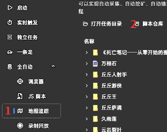
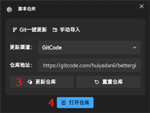
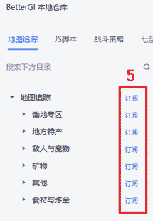
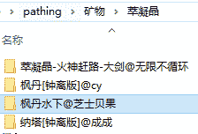
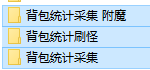
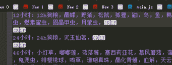
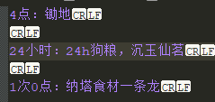
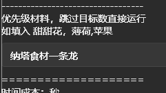
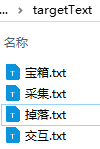
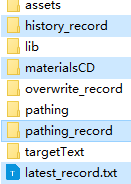

# Inventory Material Statistics v2.68  
Author: JiJiMiao (吉吉喵)  

<!-- Global image style for side-by-side display -->
<style>
  /* 1. Container for horizontal images */
  .img-row-container {
    display: flex;
    flex-wrap: wrap;
    gap: 15px;
    justify-content: center;
    align-items: flex-start;
    margin: 15px 0;
    max-width: 100%;
  }

  /* 2. Image responsive rules */
  .auto-scale-img {
    width: auto;
    max-width: 100%;
    min-width: auto;
    max-width: 600px;
    height: auto !important;
    object-fit: contain;
    display: block;
  }
</style>

## 1. Overview  
Counts character development materials, select food items, and ingredients in your inventory. Based on your configured "Target Quantities" and "Material Respawn Cooldowns", it automatically executes mining, harvesting, gathering, and mob farming routes.

### Key Features  
1. **Auto Cooldown Management**: No need to manually check respawn timers; the script automatically tracks and determines when cooldowns have expired.  
2. **Flexible Route Management**: Easily add custom routes; automatically excludes low-efficiency or invalid paths.  
3. **Independent Whitelist Recognition**: Avoids interacting with roadside NPCs or Statues of The Seven; supports custom recognition lists (see FAQ Q4).  
4. **Real-time Pop-up Protection**: Built-in modal dialog handling (covering roadside notes, expired items, Welkin Moon, investigations, etc.) to ensure routes are not interrupted.  
5. **Auto Blacklist on Full Inventory**: Integrated pickup module links with material statistics to automatically blacklist items that hit inventory caps.  
6. **Path Check Codes**: Generates check codes from route coordinates to recognize renamed paths and automatically link runtime records.  
7. **Mob Drop Overflow Protection**: Implements multi-tier safeguards against overflowing blue/purple monster materials (only picks monster materials present in the `pathing` folder and below capacity).  

## 2. Prerequisites  
1. Basic computer operation skills (e.g. copying files, navigating folders).  
2. For non-1080p monitors, adjust the inventory page **Drag Distance** setting before use (recommended: "a scroll distance slightly less than 4 rows of materials").  
3. The script does not bundle path files by default; you must copy desired path files into the script's directory (see Section 3).  

## 3. Usage Guide  

### 3.1 Basic Setup (Path Configuration)  

#### Step 1: Subscribe to Route Files  
Subscribe to your desired path repositories in BetterGI:  
<div class="img-row-container">
  
  
  
  
</div>

#### Step 2: Copy Routes to the Target Directory  
1. Open the **source route directory** (where subscribed routes are stored):  
   ```text
   BetterGI\Repos\bettergi-scripts-list-git\repo\pathing
   ```  
2. Copy the relevant route folders according to your needs:  
   - Local Specialties  
   - Enemies and Monsters  
   - Minerals  
   - Food and Alchemy  
3. Paste them into the **script's target route directory**:  
   ```text
   BetterGI\User\JsScript\InventoryMaterialStats\pathing
   ```  

#### Key Notes for Step 2:  
- Manually remove duplicate routes (e.g. multiple identical "Condessence Crystal" routes from different authors):  
  <div class="img-row-container">
    
  </div>  
- The `pathing` folder supports up to **6 nested subfolder levels**; deeper paths cannot be read.  
- Fontaine Underwater routes are highly recommended for new setups: they have no specific party requirements (just ensure underwater Teleport Waypoints are unlocked).  

#### Step 3: Organize Routes by Party Composition  
It is recommended to duplicate the script into multiple instances across different Configuration Groups, assigning suitable routes to each team comp.  
*Example: Duplicate the script 3 times, rename each, and place them in separate Configuration Groups configured with their respective party setups. Assign only routes that each team can handle (e.g., fishing, fowls, mining, mob clearing).*

| Group Name | Party Comp | Scenario | Notes |  
|---|---|---|---|  
| Gathering Group (Survival) | Dehya + Barbara + Yaoyao + Nahida | Standard material gathering | If you don't have Nahida, search and remove routes containing `nahida_collect`. |  
| Mob Farming Group | Mavuika + Citlali + Zhongli + Kaedehara Kazuha | AFK mob clearing (monster drops & combat harvesting) | Ensure high damage output for fast mob clearing. |  
| Elemental Infusion Group | Zhongli + Barbara + Kuki Shinobu + Sucrose/Bennett | Infusion-based gathering (requires specific elements) | Select infusion characters based on material requirements; add DPS if combat is involved. |  

Example grouping and removing Nahida-dependent routes:  
<div class="img-row-container">
  
  
</div>

#### Step 4: Configure JS Settings  
1. Locate the added script in your Configuration Group.  
2. Right-click and select "Edit JS Script Custom Settings".  
<div class="img-row-container">
  
</div>

### 3.2 Key JS Settings  

| Setting | Description | Recommendation |  
|---|---|---|  
| **1. Target Quantity** | When a general material drops below this quantity, its routes are queued for execution. | Default recommended. Mob drop routes are governed by Over-Cap Threshold instead. |  
| **2. Priority Materials** | Bypasses target quantity limits and prioritizes these materials at the very top of the queue. | Enter urgent materials (e.g., `Rainbowdrop Crystal`); leave empty for default. |  
| **3. Time Cost** | After 3-5 runs for a route, calculates average "time per material"; 50 represents the top 50% most efficient routes. | Keep default to filter out inefficient paths automatically. |  
| **4. Notifications** | Sends alerts after each material category and a final summary upon completion (requires BetterGI notifications enabled). | Recommended enabled. |  
| **5. Disable Inter-Route Scan** | Skips inventory scanning between individual routes, scanning only twice (before starting and after ending all routes). | Keep default; enable once 3+ valid records exist to save execution time. |  
| **6. Mob Drop Filter** | When checked, only picks drops for monsters present in `pathing` that are below capacity, ignoring all other drops. | Recommended for players with near-full inventories. |  
| **7. Over-Cap Threshold** | Materials exceeding this threshold after initial scan are removed from route and recognition lists (default: 9000). | Default recommended to avoid inventory overflow across all materials. |  
| **8. Statistics Selection** | `pathing` materials: standard & mob routes; [Scan Extra Categories]: identifies overflow items; [Estimation Mode]: estimates execution time (defaults to 2 min without records). | Adjust as needed; overflow items from extra categories are excluded from auto-pickup. |  
| **9. Pop-up Name** | Leave empty to cycle through all pop-up handlers in `assets\imageClick`; specify names to handle only selected dialogs. | Default recommended. |  
| **10. Pop-up Interval** | Pop-up polling interval (seconds, default: 15s). | Default recommended. |  
| **11. Cooldown Category** | Leave empty to execute all rules in `materialsCD`; specify to run only selected cooldown categories. | Default recommended; update rules in `materialsCD` when adding new materials. |  
| **12. Stop Time** | Scheduled termination time (24-hour format, e.g. `4:10`). Leaves 2 min margin based on estimated 5-min route time. | Default recommended. |  
| **13. Recognition List** | Leave empty to use default lists in `targetText`; specify names to run only targeted lists. | Default recommended. |  
| **14. Drag Distance** | Solves over-scrolling on non-1080p resolutions; adjust so one scroll shifts ≤ 4 rows. | Pick drag point near Row 5; decrease value for resolutions above 1080p. |  

## 4. Precautions & Notes  
1. **Disable Co-op Requests**: Incoming co-op join requests obscure the inventory UI, causing recognition failures. It is recommended to add the `AutoPermission` script beforehand to auto-reject co-op requests.  
2. **Directory Nesting Limit**: The `pathing` folder supports at most 6 folder levels; deeper structures must be flattened.  
3. **Deduplicate Routes**: Delete visibly overlapping routes for identical resource clusters to shorten setup time.  
4. **Backup Key Directories**: Periodically back up `pathing` (route files) and `pathing_record` (runtime history) to prevent record corruption.  
5. **Manual Abort**: Manually terminating a route records it in `noRecord` mode, participating in cooldown calculations without saving corrupted counts.  

## 5. FAQ  

### Q1: How do I exclude routes I don't want?  
**A**: Open `pathing` (`BetterGI\User\JsScript\InventoryMaterialStats\pathing`) and delete or move out unwanted folders. Alternatively, specify custom CD categories in settings (see Q2).  

### Q2: How do I add new materials?  
**A**:  
1. Open `materialsCD` (`BetterGI\User\JsScript\InventoryMaterialStats\materialsCD`).  
2. Edit or create a text file with the format: `CD_Rule:Material1,Material2` (e.g., `1次0点:Moonfall Silver,Nocturnal Blossom,`).  
3. **Crucial**: The route folder and item image names must match the material standard name exactly.  
<div class="img-row-container">
  
  
</div>

### Q3: How do I use non-standard route folders (e.g., "Natlan Ingredients", "Orchard.json")?  
**A**:  
1. Place the non-standard file inside an appropriate material folder (cooldowns are governed by the parent folder name).  
2. E.g., put `Orchard.json` into the `Apple` folder to follow Apple's CD rules.  
3. For custom names, add the name to `materialsCD`, set it under **Priority Materials**, and enable **Disable Inter-Route Scan**; otherwise no CD will be tracked.  
<div class="img-row-container">
  
  
  
</div>

### Q4: How do I customize recognition lists?  
**A**:  
1. Open `targetText` (`BetterGI\User\JsScript\InventoryMaterialStats\targetText`).  
2. Create or edit a `.txt` file formatted as `CustomName:Item1,Item2,`.  
3. To exclude enemy drops, open `掉落.txt` and delete the corresponding drop name.  
<div class="img-row-container">
  
  
</div>

### Q5: How do I disable scanning inventory after each route?  
**A**: Check "Disable Inter-Route Scan" in JS settings. Scans at the very beginning and end will still run.  

### Q6: What if inventory scrolling skips rows on my monitor?  
**A**: Adjust the **Drag Distance** setting in JS custom configuration so that one scroll moves slightly less than 4 rows of items.  

### Q7: Where are local records saved?  
**A**: Under `BetterGI\User\JsScript\InventoryMaterialStats\`:  
- `overwrite_record`: Historical records organized by material.  
- `history_record`: Category-specific records.  
- `latest_record.txt`: Recent material counts.  
- `pathing_record`: Complete individual route run logs (durations, yields, diff summaries; back this up regularly).  
<div class="img-row-container">
  
</div>

### Q8: Why does the script still farm monsters when Target Quantity > current count?  
**A**: Monster paths produce 3 drop tiers plus Mora. If placed under a specific material name folder, they behave as standard materials. If placed under a monster name folder, all three drops must exceed the Over-Cap Threshold before the route is skipped.  

## 6. Feedback  
Beta testing in progress. Feedback and discussions are welcome on QQ channel: `bettergiv1`.  

## 7. Changelog  

| Version | Updates |  
|---|---|  
| v0.1 - v1.32 | Added OCR lists, expanded item image packages, accelerated scanning, added reverse material recognition. |  
| v2.0 - v2.29 | Added cooldown management, optimized path sequencing, added unit-time cost metrics, added inventory popup recognition, fixed zero-yield records. |  
| v2.30 - v2.42 | Optimized memory footprint during OCR, added notifications, introduced `noRecord` mode and monster CD configurations. |  
| v2.50 - v2.59 | Added independent whitelist pickup, Welkin Moon popup handler, over-cap auto-blacklisting, multi-level popups, and bidirectional template matching. |  
| v2.60 - v2.68.2 | Route duration estimation, multiselect UI for categories/CD files/popups (requires BGI v0.55+), OCR misread correction maps, Silver Raven Insignia recognition fix, and quantity OCR fallback screenshots. |
